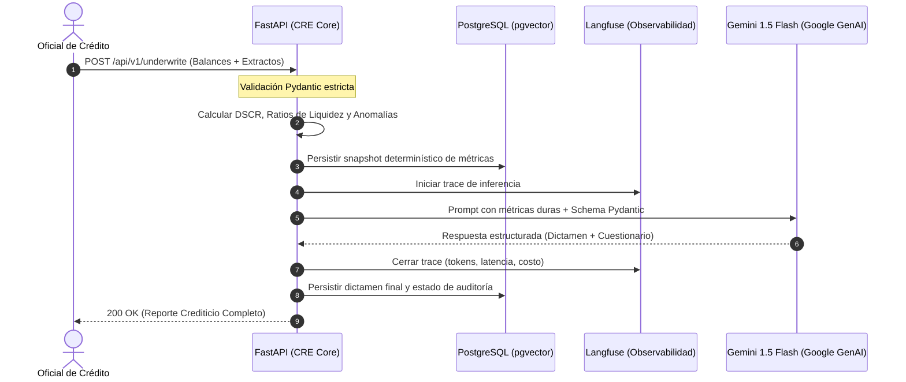
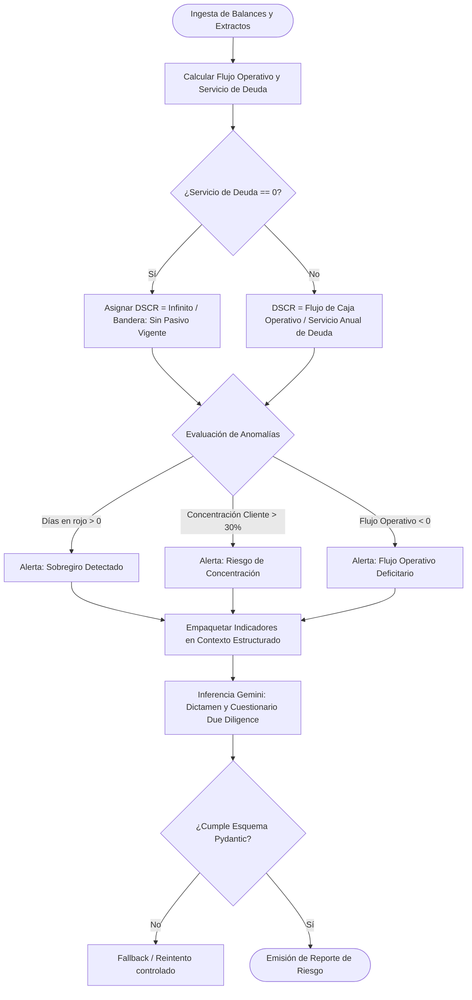

# SPEC-01: Confiamos Risk Engine (CRE) - Core Underwriting

- **Estado**: BORRADOR_APROBADO
- **Cliente**: Cooperativa Confiamos
- **Autor**: Antigravity & Jorge Sierra
- **Fecha**: 2026-10-15
- **Versión**: 1.0.0

---

## 1. Contexto de Negocio y Objetivos

### 1.1 Problema
La Cooperativa Confiamos enfrenta demoras de 3 a 5 días hábiles en la evaluación crediticia de asociados comerciales y PyMEs debido a la revisión manual de balances contables y extractos bancarios. Esto genera pérdida de solicitudes frente a competidores y riesgo de inconsistencias en la auditoría.

### 1.2 Objetivo
Construir un motor de evaluación crediticia determinístico y asistido por IA que:
1. Calcule métricas de solvencia financiera (DSCR, Liquidez, Runway) con matemática exacta en Python en < 2 segundos.
2. Detecte automáticamente anomalías de flujo de caja y concentración de riesgo.
3. Genere un dictamen crediticio preliminar y un cuestionario de Due Diligence estructurado con Gemini en < 5 segundos.
4. Reduzca el tiempo total de evaluación a menos de 10 minutos por solicitud, con auditoría completa de cada decisión.

### 1.3 Fuera de Alcance (Non-Goals)
* Créditos de consumo individual (personas naturales sin actividad comercial).
* Ejecución automática de desembolsos o transferencias bancarias.
* Procesamiento de pagos o integración con burós de crédito en esta fase inicial.

---

## 2. Diagramas Arquitectónicos (Mermaid)

### 2.1 Diagrama de Secuencia (End-to-End)


### 2.2 Diagrama de Flujo: Decisión de Capacidad de Pago (DSCR)


---

## 3. Especificación Técnica de Datos

### 3.1 Contrato de Entrada (`UnderwriteRequest`)
```json
{
  "associated_id": "CONF-98214",
  "business_name": "Distribuidora Andina SAS",
  "requested_amount_usd": 75000.0,
  "term_months": 24,
  "financial_statements": {
    "fiscal_year": 2025,
    "operating_cash_flow": 48500.0,
    "annual_debt_service": 24000.0,
    "current_assets": 120000.0,
    "current_liabilities": 65000.0,
    "total_revenue": 340000.0
  },
  "bank_statements_summary": {
    "total_inflows": 355000.0,
    "total_outflows": 310000.0,
    "negative_balance_days": 0,
    "top_client_revenue_percentage": 22.5
  }
}
```

### 3.2 Fórmulas Matemáticas Determinísticas (Python)
1. **DSCR (Debt Service Coverage Ratio)**:
   $$\text{DSCR} = \frac{\text{Flujo de Caja Operativo}}{\text{Servicio Anual de Deuda}}$$
   * $\text{DSCR} \ge 1.25$: Solvente (margen de cobertura adecuado).
   * $1.00 \le \text{DSCR} < 1.25$: Margen ajustado (requiere garantía adicional).
   * $\text{DSCR} < 1.00$: Deficitario (incapacidad de pago con flujo operativo actual).

2. **Ratio de Liquidez Corriente (Current Ratio)**:
   $$\text{Current Ratio} = \frac{\text{Activo Corriente}}{\text{Pasivo Corriente}}$$
   * Óptimo bancario: $\ge 1.30$.

### 3.3 Esquema de Salida de IA (`UnderwritingVerdict`)
```python
class CreditRecommendation(str, Enum):
    APROBADO = "APROBADO"
    APROBADO_CONDICIONADO = "APROBADO_CONDICIONADO"
    RECHAZADO = "RECHAZADO"

class UnderwritingVerdict(BaseModel):
    recommendation: CreditRecommendation
    confidence_score: float = Field(ge=0.0, le=1.0)
    executive_summary: str
    key_strengths: list[str]
    identified_risks: list[str]
    due_diligence_questions: list[str]
```

---

## 4. Casos Límite y Manejo de Errores (Edge Cases)

1. **Servicio de Deuda Igual a Cero**:
   * *Riesgo*: División por cero en el cálculo de DSCR.
   * *Manejo*: Asignar valor especial `None` y flag `is_debt_free = True`. La IA debe evaluar solvencia basada en margen operativo y capital de trabajo.
2. **Empresa con Alta Facturación pero Flujo de Caja Negativo**:
   * *Riesgo*: Alucinación de solvencia si el modelo se guía por ingresos brutos en vez de cash flow real.
   * *Manejo*: El validador determinístico inyecta una advertencia obligatoria `CRITICAL_WARNING: Negative operating cash flow despite high revenue`.
3. **Falla o Timeout del Proveedor de LLM (Gemini)**:
   * *Riesgo*: Bloqueo del endpoint.
   * *Manejo*: Circuit breaker con timeout estricto de 8s y fallback a reporte determinístico preliminar marcado como `REQUIRES_MANUAL_REVIEW`.

---

## 5. Criterios de Aceptación (Tests Automatizados)

* **TEST-01 (Unit)**: El cálculo de DSCR debe arrojar exactamente `2.0208` para un flujo de $48,500 y deuda de $24,000 con tolerancia de 4 decimales.
* **TEST-02 (Unit)**: Manejo de deuda $0 sin excepción `ZeroDivisionError`.
* **TEST-03 (Evals)**: La respuesta de Gemini debe deserializar al 100% en el modelo `UnderwritingVerdict` sin campos faltantes.
* **TEST-04 (Trace)**: Toda solicitud debe generar un trace en Langfuse con el `trace_id` persistido en PostgreSQL.
