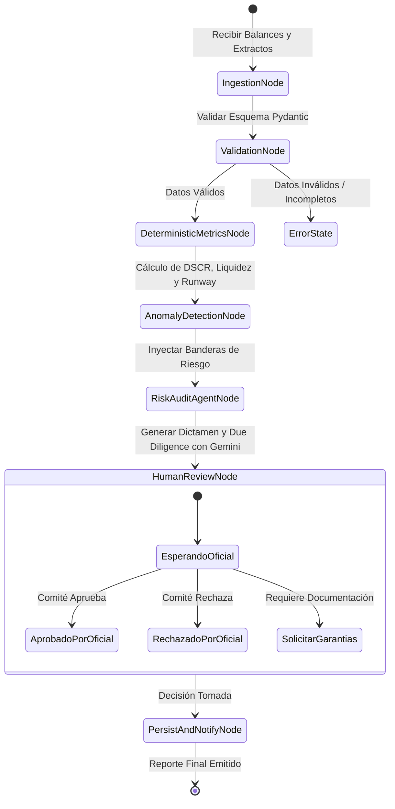
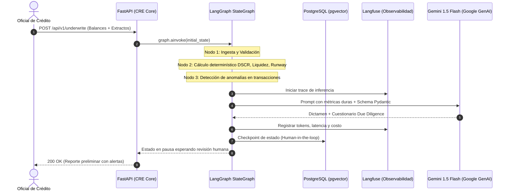

# SPEC-01: Confiamos Risk Engine (CRE) - Core Underwriting

- **Estado**: APROBADO
- **Cliente**: Cooperativa Confiamos
- **Orquestador**: LangGraph (StateGraph)
- **Autor**: Antigravity & Jorge Sierra
- **Fecha**: 2026-10-15
- **Versión**: 1.1.0

---

## 1. Contexto de Negocio y Objetivos

### 1.1 Problema
La Cooperativa Confiamos enfrenta demoras de 3 a 5 días hábiles en la evaluación crediticia de asociados comerciales y PyMEs debido a la revisión manual de balances contables y extractos bancarios. Esto genera pérdida de solicitudes frente a competidores y riesgo de inconsistencias en la auditoría.

### 1.2 Objetivo
Construir un motor de evaluación crediticia determinístico y asistido por IA que:
1. Calcule métricas de solvencia financiera (DSCR, Liquidez, Runway) con matemática exacta en Python en < 2 segundos.
2. Orqueste el flujo de evaluación con una máquina de estados determinística usando **LangGraph**.
3. Detecte automáticamente anomalías de flujo de caja y concentración de riesgo.
4. Genere un dictamen crediticio preliminar y un cuestionario de Due Diligence estructurado con Gemini en < 5 segundos.
5. Permita intervención y aprobación humana (*Human-in-the-loop*) del oficial de crédito antes de emitir la resolución final.

### 1.3 Fuera de Alcance (Non-Goals)
* Créditos de consumo individual (personas naturales sin actividad comercial).
* Ejecución automática de desembolsos o transferencias bancarias.
* Procesamiento de pagos o integración con burós de crédito en esta fase inicial.

---

## 2. Diagramas Arquitectónicos (Mermaid)

### 2.1 Máquina de Estados del Crédito en LangGraph (`StateGraph`)


### 2.2 Diagrama de Secuencia (End-to-End con LangGraph)


---

## 3. Especificación del Estado en LangGraph (`CreditUnderwritingState`)

```python
from typing import TypedDict, Optional, List
from pydantic import BaseModel, Field
from enum import Enum

class CreditRecommendation(str, Enum):
    APROBADO = "APROBADO"
    APROBADO_CONDICIONADO = "APROBADO_CONDICIONADO"
    RECHAZADO = "RECHAZADO"

class FinancialMetrics(BaseModel):
    dscr: Optional[float] = Field(description="Debt Service Coverage Ratio")
    current_ratio: float = Field(description="Ratio de liquidez corriente")
    runway_months: Optional[float] = Field(description="Meses de caja restante")
    operating_cash_flow: float
    annual_debt_service: float
    is_debt_free: bool = False

class UnderwritingVerdict(BaseModel):
    recommendation: CreditRecommendation
    confidence_score: float = Field(ge=0.0, le=1.0)
    executive_summary: str
    key_strengths: List[str]
    identified_risks: List[str]
    due_diligence_questions: List[str]

class CreditUnderwritingState(TypedDict):
    associated_id: str
    business_name: str
    requested_amount_usd: float
    term_months: int
    raw_financials: dict
    raw_statements: dict
    metrics: Optional[FinancialMetrics]
    anomaly_flags: List[str]
    ai_verdict: Optional[UnderwritingVerdict]
    human_approved: Optional[bool]
    human_notes: Optional[str]
    current_step: str
```

---

## 4. Fórmulas Matemáticas Determinísticas (Python)

1. **DSCR (Debt Service Coverage Ratio)**:
   $$\text{DSCR} = \frac{\text{Flujo de Caja Operativo}}{\text{Servicio Anual de Deuda}}$$
   * $\text{DSCR} \ge 1.25$: Solvente (margen de cobertura adecuado).
   * $1.00 \le \text{DSCR} < 1.25$: Margen ajustado (requiere garantía adicional).
   * $\text{DSCR} < 1.00$: Deficitario (incapacidad de pago con flujo operativo actual).

2. **Ratio de Liquidez Corriente (Current Ratio)**:
   $$\text{Current Ratio} = \frac{\text{Activo Corriente}}{\text{Pasivo Corriente}}$$
   * Óptimo bancario: $\ge 1.30$.

3. **Runway (Meses de Caja)**:
   $$\text{Runway} = \frac{\text{Efectivo Disponible}}{\text{Gasto Neto Mensual (Burn Rate)}}$$

---

## 5. Casos Límite y Manejo de Errores (Edge Cases)

1. **Servicio de Deuda Igual a Cero**:
   * *Riesgo*: División por cero en el cálculo de DSCR.
   * *Manejo*: Asignar `dscr = None` y `is_debt_free = True`. La IA evalúa la capacidad de endeudamiento inicial basada en flujo libre.
2. **Alta Facturación con Flujo Operativo Negativo**:
   * *Riesgo*: El modelo aprueba engañado por la facturación bruta.
   * *Manejo*: Nodo de anomalías inyecta la bandera obligatoria `FLAG_NEGATIVE_OPERATING_CASH_FLOW`.
3. **Falla de Conectividad con Gemini**:
   * *Riesgo*: Caída del StateGraph.
   * *Manejo*: LangGraph reintenta con backoff exponencial (máx 2 reintentos); si falla, detiene el grafo en estado `FALLBACK_MANUAL_REVIEW`.

---

## 6. Criterios de Aceptación (Tests Automatizados)

* **TEST-01 (Unit)**: El cálculo de DSCR debe arrojar exactamente `2.0208` para un flujo de $48,500 y deuda de $24,000 con tolerancia de 4 decimales.
* **TEST-02 (Unit)**: Manejo de deuda $0 sin excepción `ZeroDivisionError`.
* **TEST-03 (StateGraph)**: El grafo de LangGraph debe transitar los 4 nodos determinísticos sin error antes de llamar al agente de IA.
* **TEST-04 (Evals)**: La respuesta de Gemini debe deserializar al 100% en el modelo `UnderwritingVerdict`.
* **TEST-05 (Trace)**: Toda ejecución del grafo debe quedar trazada en Langfuse.
