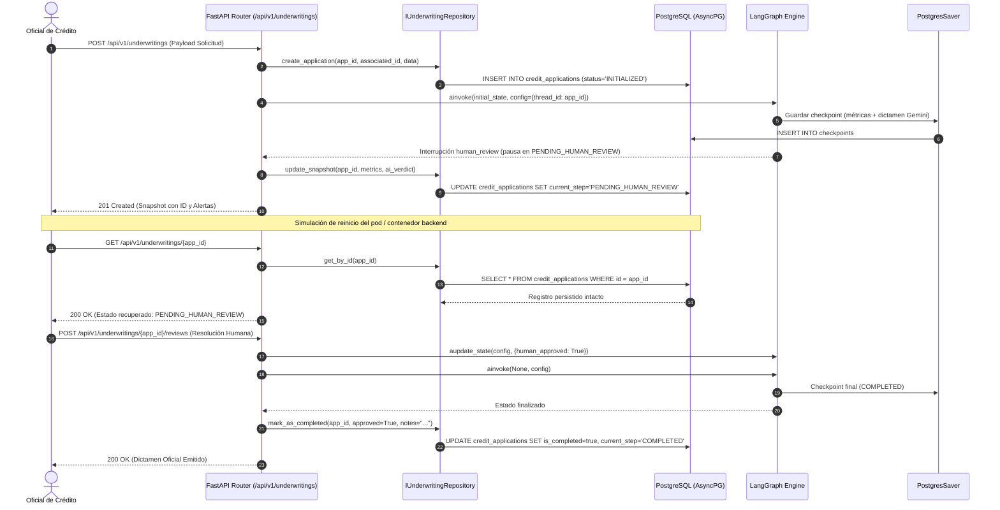
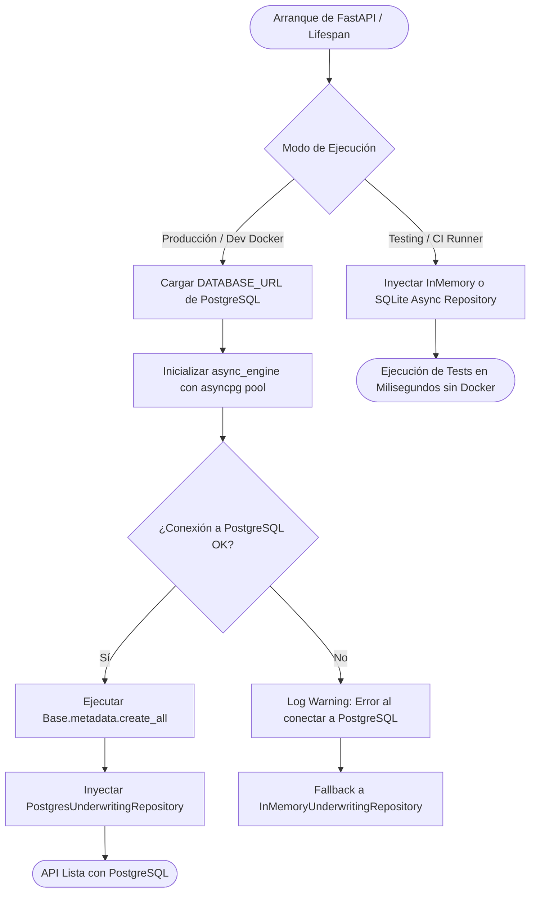
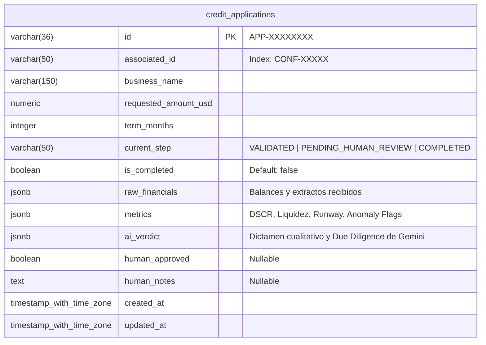

# SPEC-02: Confiamos Risk Engine (CRE) - Persistencia Relacional y Checkpointing con PostgreSQL

- **Estado**: APROBADO
- **Cliente**: Cooperativa Confiamos
- **Base de Datos**: PostgreSQL 16 (pgvector/pgvector:pg16) + SQLAlchemy 2.0 (AsyncIO / asyncpg)
- **Autor**: Antigravity & Jorge Sierra
- **Fecha**: 2026-10-15
- **Versión**: 1.0.0

---

## 1. Contexto de Negocio y Objetivos

### 1.1 Problema
En el MVP (SPEC-01), el motor de evaluación crediticia gestiona el estado del `StateGraph` exclusivamente en memoria (`MemorySaver`). En el entorno bancario de la **Cooperativa Confiamos**, esto introduce riesgos operacionales críticos:
1. **Pérdida de datos por reinicios**: Si el servicio de backend se reinicia (por despliegue, escalado o caída inesperada), todas las solicitudes crediticias en estado `PENDING_HUMAN_REVIEW` se pierden.
2. **Falta de trazabilidad y auditoría histórica**: La cooperativa requiere mantener el registro histórico inmutable de balances financieros recibidos, métricas calculadas, dictamen generado por Gemini y la resolución final del oficial de crédito para auditorías regulatorias.
3. **Imposibilidad de consultar bandejas de trabajo**: Los oficiales de crédito no pueden listar de forma paginada las solicitudes pendientes de resolución.

### 1.2 Objetivo
Implementar una capa de persistencia relacional transaccional y duradera que:
1. Almacene las solicitudes de crédito y sus estados en **PostgreSQL 16** mediante modelos declarativos de **SQLAlchemy 2.0** con driver asíncrono **asyncpg**.
2. Integre checkpointing persistente en base de datos para **LangGraph**, permitiendo reanudar cualquier flujo interrumpido por su `thread_id` tras un reinicio de la API.
3. Aísle el acceso a datos mediante el **Patrón Repositorio (`IUnderwritingRepository`)**, permitiendo ejecutar la suite de CI y tests unitarios en memoria o SQLite sin requerir contenedores activos de Docker.
4. Exponga el endpoint de listado paginado `GET /api/v1/underwritings?limit=20&offset=0&status=PENDING_HUMAN_REVIEW` conforme al estándar estricto de APIs REST (FreeCodeCamp).

### 1.3 Fuera de Alcance (Non-Goals)
* Búsqueda por similitud vectorial con embeddings en esta fase (pgvector está instalado y provisionado en Docker, pero se utilizará en SPEC-03 para análisis semántico de solvencia histórica).
* Autenticación basada en JWT / OAuth2 (se abordará en el módulo de seguridad).

---

## 2. Diagramas Arquitectónicos (Mermaid)

### 2.1 Diagrama de Secuencia: Ciclo Transaccional y Reanudación de Estados


### 2.2 Diagrama de Flujo: Gestión de Conexiones y Resiliencia en Pruebas


---

## 3. Modelo de Datos Relacional (PostgreSQL 16)



### 3.1 DDL de Referencia

```sql
CREATE TABLE IF NOT EXISTS credit_applications (
    id VARCHAR(36) PRIMARY KEY,
    associated_id VARCHAR(50) NOT NULL,
    business_name VARCHAR(150) NOT NULL,
    requested_amount_usd NUMERIC(15, 2) NOT NULL,
    term_months INTEGER NOT NULL,
    current_step VARCHAR(50) NOT NULL DEFAULT 'INITIALIZED',
    is_completed BOOLEAN NOT NULL DEFAULT FALSE,
    raw_financials JSONB NOT NULL,
    metrics JSONB NULL,
    ai_verdict JSONB NULL,
    human_approved BOOLEAN NULL,
    human_notes TEXT NULL,
    created_at TIMESTAMP WITH TIME ZONE DEFAULT CURRENT_TIMESTAMP NOT NULL,
    updated_at TIMESTAMP WITH TIME ZONE DEFAULT CURRENT_TIMESTAMP NOT NULL
);

CREATE INDEX IF NOT EXISTS idx_credit_applications_associated_id 
    ON credit_applications (associated_id);

CREATE INDEX IF NOT EXISTS idx_credit_applications_current_step 
    ON credit_applications (current_step);
```

---

## 4. Contratos de Interfaz del Repositorio

```python
from abc import ABC, abstractmethod
from typing import Any, Optional

class IUnderwritingRepository(ABC):
    """Contrato abstracto para desacoplar el acceso a datos del dominio."""

    @abstractmethod
    async def create_application(
        self,
        application_id: str,
        associated_id: str,
        business_name: str,
        requested_amount_usd: float,
        term_months: int,
        raw_financials: dict[str, Any],
    ) -> dict[str, Any]:
        """Crea el registro inicial de una solicitud crediticia."""
        ...

    @abstractmethod
    async def get_by_id(self, application_id: str) -> Optional[dict[str, Any]]:
        """Recupera la solicitud por su ID único."""
        ...

    @abstractmethod
    async def list_applications(
        self,
        limit: int = 20,
        offset: int = 0,
        status: Optional[str] = None,
    ) -> list[dict[str, Any]]:
        """Retorna una lista paginada de solicitudes con filtro de estado opcional."""
        ...

    @abstractmethod
    async def update_snapshot(
        self,
        application_id: str,
        current_step: str,
        metrics: Optional[dict[str, Any]] = None,
        ai_verdict: Optional[dict[str, Any]] = None,
    ) -> dict[str, Any]:
        """Actualiza el estado intermedio y resultados de cómputo del StateGraph."""
        ...

    @abstractmethod
    async def submit_human_review(
        self,
        application_id: str,
        approved: bool,
        notes: str,
        current_step: str = "COMPLETED",
    ) -> dict[str, Any]:
        """Registra la intervención humana y marca la solicitud como completada."""
        ...
```

---

## 5. Casos Límite y Manejo de Errores (Edge Cases)

1. **Caída o indisponibilidad de PostgreSQL al inicio**:
   * *Manejo*: La aplicación no debe abortar en entornos de prueba si `TESTING=true`. Se inicializa con el repositorio en memoria para no romper suites automáticas. En producción, emite un error `503 Service Unavailable` controlado.
2. **Recuperación de `thread_id` inexistente en LangGraph**:
   * *Manejo*: Si se consulta un ID inexistente, el repositorio retorna `None` y FastAPI responde de inmediato con `404 Not Found` sin llamar al StateGraph.
3. **Escritura concurrente de revisión humana**:
   * *Manejo*: Si dos oficiales intentan dictaminar la misma solicitud simultáneamente, una vez que `is_completed=True`, cualquier intento posterior de revisión retorna `409 Conflict` indicando que el crédito ya fue resuelto.

---

## 6. Criterios de Aceptación (Tests Automatizados)

* **TEST-01 (Unit)**: `InMemoryUnderwritingRepository` debe pasar el 100% de operaciones CRUD (crear, consultar, paginar y actualizar).
* **TEST-02 (SQLAlchemy)**: `PostgresUnderwritingRepository` debe persistir y consultar correctamente con sesión asíncrona (`AsyncSession`) serializando los campos JSONB.
* **TEST-03 (StateGraph Continuity)**: Tras ejecutar la primera fase hasta `PENDING_HUMAN_REVIEW`, reiniciar la instancia del grafo y llamar a reanudar con el mismo `thread_id` debe completar el flujo hasta `COMPLETED` sin perder las métricas iniciales.
* **TEST-04 (REST API Plural)**: Endpoint `GET /api/v1/underwritings` debe responder con paginación (`limit`, `offset`) y `200 OK`.
* **TEST-05 (Ruff & CI)**: Todos los nuevos módulos y tests deben cumplir la regla de 100 caracteres de Ruff y pasar en GitHub Actions.
