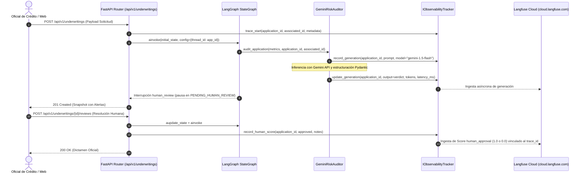
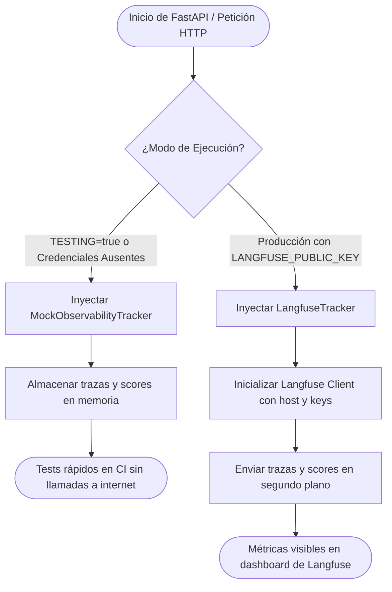

# SPEC-03: Confiamos Risk Engine (CRE) - Observabilidad, Evaluación y Trazabilidad con Langfuse

- **Estado**: APROBADO
- **Cliente**: Cooperativa Confiamos
- **Plataforma de Observabilidad**: Langfuse (`langfuse>=2.54.0`)
- **Autor**: Antigravity & Jorge Sierra
- **Fecha**: 2026-10-15
- **Versión**: 1.0.0

---

## 1. Contexto de Negocio y Objetivos

### 1.1 Problema
En las fases anteriores (SPEC-01 y SPEC-02), **Confiamos Risk Engine** calcula métricas de solvencia determinísticas, persiste solicitudes en PostgreSQL y consulta a Google Gemini para obtener dictámenes cualitativos estructurados. Sin embargo, en el ámbito bancario y cooperativo, la inferencia con LLMs no puede operar como una caja negra:
1. **Falta de auditoría regulatoria del prompt**: No existe un registro inmutable del contexto exacto y los balances financieros que fueron enviados al modelo de IA en cada solicitud.
2. **Desconocimiento de latencia y costos de tokens**: La cooperativa no puede monitorear el consumo de tokens (prompt vs completion), el gasto en USD ni las fluctuaciones de latencia de la API de Gemini.
3. **Ausencia de métricas de alineación humano-IA**: No se mide de forma cuantitativa cuántas recomendaciones de Gemini son aprobadas o rechazadas por los oficiales de crédito humanos (*Human Agreement Rate*).

### 1.2 Objetivo
Implementar una capa de observabilidad desacoplada y trazabilidad completa con **Langfuse** que:
1. Registre trazas correlacionadas directamente con `trace_id = application_id` (`APP-XXXXXXXX`) y `user_id = associated_id` (`CONF-XXXXX`), unificando PostgreSQL, FastAPI y Langfuse.
2. Capture cada llamada a Gemini como una `generation` con prompt exacto, tiempo de respuesta en milisegundos, conteo de tokens (`usage_metadata`) y el dictamen estructurado `UnderwritingVerdict`.
3. Registre un `score` numérico (`human_approval = 1.0` si aprueba, `0.0` si rechaza) vinculado a la traza cuando el oficial humano emite su resolución en `POST /api/v1/underwritings/{id}/reviews`.
4. Aísle el acceso a Langfuse mediante el contrato `IObservabilityTracker` con fallback a `MockObservabilityTracker` en testing (`TESTING=true`) o cuando no existan credenciales, garantizando que los tests en CI sigan ejecutándose en milisegundos sin llamadas externas a internet.

### 1.3 Fuera de Alcance (Non-Goals)
* Prompt Management dinámico descargado desde Langfuse Cloud en tiempo de ejecución (se mantiene el template tipado en código para reproducibilidad bancaria).
* Tracing distribuido con OpenTelemetry para servicios externos a la API.

---

## 2. Diagramas Arquitectónicos (Mermaid)

### 2.1 Diagrama de Secuencia: Ciclo de Trazabilidad y Evaluación Humana


### 2.2 Diagrama de Flujo: Resolución de Tracker y Resiliencia en Pruebas


---

## 3. Contratos de Interfaz de Observabilidad

```python
from typing import Any, Protocol

class IObservabilityTracker(Protocol):
    """Protocolo abstracto para trazabilidad y auditoría de IA."""

    def trace_start(
        self,
        application_id: str,
        associated_id: str,
        business_name: str,
        requested_amount_usd: float,
        term_months: int,
    ) -> None:
        """Inicia el contexto de la traza para una solicitud crediticia."""
        ...

    def record_generation(
        self,
        application_id: str,
        model_name: str,
        prompt: str,
        output: dict[str, Any],
        usage: dict[str, int] | None = None,
        latency_ms: float = 0.0,
    ) -> None:
        """Registra la inferencia cualitativa realizada por Gemini."""
        ...

    def record_human_score(
        self,
        application_id: str,
        approved: bool,
        notes: str,
    ) -> None:
        """Registra el dictamen humano como un score en Langfuse."""
        ...

    def flush(self) -> None:
        """Fuerza el envío de eventos pendientes."""
        ...
```

---

## 4. Estructura de Datos y Métricas de Observabilidad

### 4.1 Metadatos de la Traza (`Trace`)
* **`id`**: Coincide con `application_id` (`APP-XXXXXXXX`).
* **`userId`**: Coincide con `associated_id` (`CONF-XXXXX`).
* **`name`**: `"credit_underwriting_lifecycle"`.
* **`tags`**: `["underwriting", "confiamos-risk-engine", "commercial-credit"]`.
* **`metadata`**:
  * `business_name`: Razón social.
  * `requested_amount_usd`: Monto solicitado.
  * `term_months`: Plazo en meses.

### 4.2 Inferencia del Modelo (`Generation`)
* **`name`**: `"gemini_risk_auditor"`.
* **`model`**: `"gemini-1.5-flash"`.
* **`input`**: Texto exacto del prompt con indicadores financieros determinísticos.
* **`output`**: Diccionario serializado de `UnderwritingVerdict`.
* **`usage`**:
  * `prompt_tokens`: Conteo de tokens de entrada.
  * `completion_tokens`: Conteo de tokens de salida.
  * `total_tokens`: Suma total de tokens.
* **`latency`**: Tiempo transcurrido en segundos / milisegundos.

### 4.3 Puntuación de Acuerdo Humano (`Score`)
* **`traceId`**: `application_id`.
* **`name`**: `"human_approval"`.
* **`value`**: `1.0` si `human_approved=True`, `0.0` si `human_approved=False`.
* **`comment`**: Notas y justificación redactadas por el oficial de crédito.

---

## 5. Casos Límite y Manejo de Errores (Edge Cases)

1. **Credenciales de Langfuse no configuradas o red inaccesible**:
   * *Manejo*: La aplicación no debe arrojar excepciones que interrumpan el flujo crediticio. Todas las operaciones de envío capturan excepciones de red y registran una advertencia (*graceful degradation*).
2. **Inferencia en modo Mock (`MockGeminiAuditor`)**:
   * *Manejo*: `MockGeminiAuditor` genera un registro sintético de generación con latencia calculada y conteo de tokens estimado, permitiendo validar la integración completa sin invocar a Google.
3. **Múltiples llamadas a `record_human_score`**:
   * *Manejo*: Solo se registra el score si la solicitud no había sido finalizada previamente (`is_completed=False`), en sincronía con el control `409 Conflict`.

---

## 6. Criterios de Aceptación (Tests Automatizados)

* **TEST-01 (MockTracker CRUD)**: `MockObservabilityTracker` debe almacenar en memoria la traza, generación y score humano de forma estructurada.
* **TEST-02 (Gemini Integration)**: La ejecución de `audit_application` debe registrar la generación en el tracker con prompt, output y latencia.
* **TEST-03 (Human Review Score)**: Al enviar `POST /api/v1/underwritings/{id}/reviews`, el score `human_approval` debe ser registrado con valor `1.0` o `0.0` y notas asociadas.
* **TEST-04 (Offline Safety)**: Con `TESTING=true`, ningún test debe intentar conectar a `cloud.langfuse.com`.
* **TEST-05 (Ruff & Quality)**: Todo el código nuevo debe cumplir con las reglas estrictas de formateo y longitud de línea (<= 100 chars).
