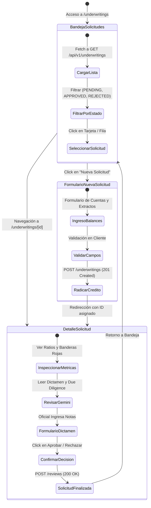
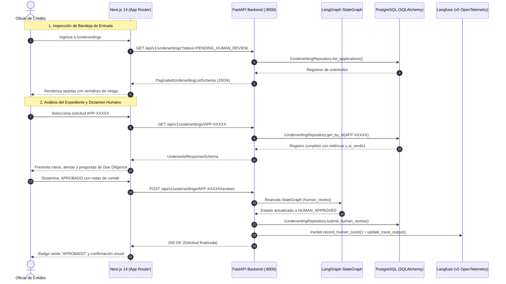

# SPEC-04: Confiamos Risk Engine (CRE) - Dashboard Web de Oficiales de Crédito

- **Estado**: APROBADO
- **Cliente**: Cooperativa Confiamos
- **Stack Frontend**: Next.js 14 (App Router) + TypeScript + TailwindCSS + Lucide Icons + Recharts
- **Autor**: Antigravity & Jorge Sierra
- **Fecha**: 2026-10-15
- **Versión**: 1.0.0

---

## 1. Contexto de Negocio y Objetivos

### 1.1 Problema
Los oficiales de crédito de la **Cooperativa Confiamos** necesitan una interfaz gráfica web moderna, clara y ágil para:
1. Inspeccionar la bandeja de solicitudes comerciales pendientes de dictamen.
2. Analizar visualmente los indicadores contables calculados por el motor determinístico (DSCR, Liquidez, Runway) sin tener que interpretar datos crudos en JSON.
3. Revisar el dictamen preliminar y las preguntas de Due Diligence sugeridas por Gemini 1.5 Flash.
4. Emitir el dictamen vinculante (*Human-in-the-loop*) aprobando o rechazando la solicitud con notas del comité antes del desembolso.

### 1.2 Objetivo de Negocio
Desarrollar una aplicación web empresarial en `apps/web` que consuma la API REST de FastAPI (`/api/v1/underwritings`), garantizando:
- **Claridad cognitiva**: Semáforos visuales para los ratios financieros (Verde = Seguro, Amarillo = Alerta, Rojo = Crítico).
- **Control de auditoría**: Desglose claro de las anomalías detectadas (sobregiros, flujos negativos, concentración de clientes).
- **Intervención humana segura**: Confirmación y bloqueo de edición para solicitudes ya finalizadas (`409 Conflict`).
- **Simulación y radicación**: Formulario interactivo para radicar nuevas solicitudes crediticias comerciales.

### 1.3 Fuera de Alcance (Non-Goals)
- Módulos de tesorería, transferencias bancarias o dispersión de fondos.
- Autenticación multifactor o conexión a proveedores OAuth externos (se asume oficial logueado en red interna de la cooperativa en esta fase).
- Firma digital criptográfica de pagarés (reservado para fase posterior).

---

## 2. Diagramas Arquitectónicos (Mermaid)

### 2.1 Flujo de Navegación y Estados de la UI


### 2.2 Diagrama de Secuencia de Integración End-to-End


---

## 3. Arquitectura del Frontend (`apps/web`)

### 3.1 Estructura de Directorios
```text
apps/web/
├── package.json
├── tsconfig.json
├── tailwind.config.ts
├── postcss.config.js
├── next.config.mjs
└── src/
    ├── app/
    │   ├── globals.css
    │   ├── layout.tsx
    │   ├── page.tsx                           # Redirección a /underwritings
    │   └── underwritings/
    │       ├── page.tsx                       # Bandeja de entrada con filtros
    │       ├── new/
    │       │   └── page.tsx                   # Radicación de nueva solicitud
    │       └── [id]/
    │           └── page.tsx                   # Expediente y resolución humana
    ├── components/
    │   ├── Navbar.tsx                         # Header corporativo Confiamos
    │   ├── MetricCard.tsx                     # Tarjeta de ratio con semáforo
    │   ├── VerdictBadge.tsx                   # Badge con iconografía de estado
    │   ├── AnomalyAlertList.tsx               # Alertas de sobregiro y concentración
    │   └── HumanReviewForm.tsx                # Formulario con validación y confirmación
    ├── lib/
    │   ├── api.ts                             # Cliente HTTP tipado hacia FastAPI
    │   └── utils.ts                           # Formateo de moneda, porcentajes y fechas
    └── types/
        └── underwriting.ts                    # Modelos de datos TypeScript
```

### 3.2 Patrones de Diseño
1. **Container-Presentational Pattern**:
   - Páginas (`page.tsx`) manejan el fetch de datos, estados de carga y manejo de errores.
   - Componentes (`MetricCard`, `VerdictBadge`, etc.) son puramente presentacionales y desacoplados.
2. **Defensive UI & Estados Vacíos**:
   - Mensajes contextuales cuando no hay solicitudes pendientes.
   - Deshabilitación de botones de acción cuando una solicitud ya fue resuelta (`is_completed = true`).
3. **Semáforo Financiero Corporativo**:
   - `DSCR >= 1.25`: Verde (`bg-emerald-50 text-emerald-700 border-emerald-200`).
   - `1.0 <= DSCR < 1.25`: Amarillo/Ámbar (`bg-amber-50 text-amber-700 border-amber-200`).
   - `DSCR < 1.0`: Rojo crítico (`bg-rose-50 text-rose-700 border-rose-200`).

---

## 4. Contratos de Datos (TypeScript)

```typescript
export type CreditRecommendation = "APROBADO" | "APROBADO_CONDICIONADO" | "RECHAZADO";

export interface MetricsSummary {
  dscr: number | null;
  current_ratio: number | null;
  runway_months: number | null;
  is_solvent: boolean;
  is_debt_free: boolean;
  anomaly_flags: string[];
}

export interface UnderwritingVerdict {
  recommendation: CreditRecommendation;
  confidence_score: number;
  executive_summary: string;
  key_strengths: string[];
  identified_risks: string[];
  due_diligence_questions: string[];
}

export interface UnderwritingRecord {
  application_id: string;
  associated_id: string;
  business_name: string;
  current_step: string;
  is_completed: boolean;
  metrics: MetricsSummary | null;
  ai_verdict: UnderwritingVerdict | null;
  human_approved: boolean | null;
  human_notes: string | null;
  errors: string[];
}

export interface CreateUnderwritingPayload {
  associated_id: string;
  business_name: string;
  requested_amount_usd: number;
  term_months: number;
  financial_data: {
    operating_cash_flow: number;
    annual_debt_service: number;
    current_assets: number;
    current_liabilities: number;
    cash_balance: number;
    monthly_burn_rate: number;
    negative_balance_days: number;
    top_client_revenue_percentage: number;
  };
}

export interface HumanReviewPayload {
  approved: boolean;
  notes: string;
}
```

---

## 5. Criterios de Aceptación y Validación

1. **Bandeja de Entrada**:
   - Carga la lista de solicitudes desde `GET /api/v1/underwritings`.
   - Permite filtrar por `PENDING_HUMAN_REVIEW` y ver el total de casos.
2. **Visualización de Expediente**:
   - Presenta las métricas de DSCR, liquidez y runway con formato financiero estándar (`$`, `,`, `.`).
   - Muestra las banderas de riesgo y las preguntas sugeridas por Gemini.
3. **Resolución Humana**:
   - Envía el dictamen al endpoint `POST /api/v1/underwritings/{id}/reviews`.
   - Actualiza la interfaz inmediatamente reflejando el nuevo estado.
   - Deshabilita el envío si la solicitud ya está finalizada.
4. **Calidad de Código**:
   - Cero errores en `npm run lint` y tipado estricto con `tsc --noEmit`.
   - Compatibilidad completa con la suite backend existente de 32 tests.
