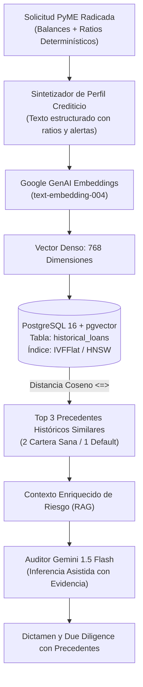
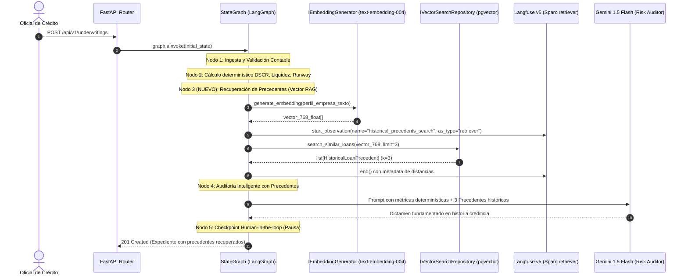

# SPEC-05: Confiamos Risk Engine (CRE) - Búsqueda Semántica de Riesgo Histórico con pgvector

- **Estado**: APROBADO
- **Cliente**: Cooperativa Confiamos
- **Stack Tecnológico**: PostgreSQL + `pgvector` + Google GenAI (`text-embedding-004`) + LangGraph + SQLAlchemy 2.0
- **Autor**: Antigravity & Jorge Sierra
- **Fecha**: 2026-10-15
- **Versión**: 1.0.0

---

## 1. Contexto de Negocio y Objetivos

### 1.1 Problema
Evaluar solicitudes de crédito PyME de forma aislada (únicamente con los balances del último periodo) expone a la **Cooperativa Confiamos** a puntos ciegos:
- Empresas con métricas cuantitativas aparentemente al límite que pertenecen a sectores con alta resiliencia estacional y récord de cumplimiento histórico.
- Empresas con ratios aparentemente aceptables pero que presentan patrones cualitativos idénticos a créditos comerciales que terminaron en cesación de pagos (*default* o mora castigada).

### 1.2 Objetivo
Implementar un subsistema de **RAG Semántico de Riesgo** (*Retrieval-Augmented Underwriting*) mediante la extensión `pgvector` de PostgreSQL y embeddings de Google GenAI (`text-embedding-004`, vector de 768 dimensiones) que permita:
1. Sintetizar el perfil crediticio del solicitante (sector, monto, ratios de cobertura, anomalías de flujo y liquidez) en un vector denso de 768 dimensiones.
2. Ejecutar una consulta de vecinos más cercanos (*k-NN*) con distancia coseno (`<=>`) en la base de datos de créditos históricos de Confiamos para extraer los 3 casos más análogos (`k=3`).
3. Inyectar los precedentes históricos (ratios, desenlace de cartera sana vs. mora, y lecciones aprendidas) en el prompt de auditoría de Gemini en LangGraph.
4. Fortalecer el dictamen con evidencia histórica antes de transferir el caso al oficial de crédito (*Human-in-the-loop*).

### 1.3 Fuera de Alcance (Non-Goals)
- Modelos de Deep Learning / Graph Neural Networks para scoring masivo no supervisado.
- Re-entrenamiento o fine-tuning de modelos de embeddings base.
- Conexión en tiempo real con bases de datos de centrales de riesgo externas en esta fase.

---

## 2. Diagramas Arquitectónicos (Mermaid)

### 2.1 Flujo del Pipeline Vectorial y Almacenamiento Semántico


### 2.2 Diagrama de Secuencia en el StateGraph de LangGraph


---

## 3. Esquema de Base de Datos DDL (`pgvector`)

### 3.1 Migración SQL para PostgreSQL
```sql
-- 1. Habilitar extensión vectorial
CREATE EXTENSION IF NOT EXISTS vector;

-- 2. Tabla de Cartera Histórica de Créditos
CREATE TABLE IF NOT EXISTS historical_loans (
    id SERIAL PRIMARY KEY,
    loan_id VARCHAR(50) UNIQUE NOT NULL,
    associated_id VARCHAR(50) NOT NULL,
    business_name VARCHAR(255) NOT NULL,
    sector VARCHAR(100) NOT NULL,
    requested_amount_usd NUMERIC(15, 2) NOT NULL,
    term_months INT NOT NULL,
    dscr NUMERIC(5, 2) NOT NULL,
    current_ratio NUMERIC(5, 2) NOT NULL,
    anomaly_flags JSONB DEFAULT '[]'::jsonb,
    outcome VARCHAR(50) NOT NULL, -- 'CARTERA_SANA' | 'DEFAULT_MORA' | 'REESTRUCTURADO'
    outcome_summary TEXT NOT NULL,
    embedding VECTOR(768) NOT NULL,
    created_at TIMESTAMP WITH TIME ZONE DEFAULT CURRENT_TIMESTAMP
);

-- 3. Índice IVFFlat para aceleración de consultas de similitud coseno
CREATE INDEX IF NOT EXISTS idx_historical_loans_embedding_cosine 
ON historical_loans 
USING ivfflat (embedding vector_cosine_ops) 
WITH (lists = 100);
```

---

## 4. Contratos de Interfaz en Python

### 4.1 Entidades de Dominio
```python
from dataclasses import dataclass
from enum import Enum
from typing import Protocol, Any

class LoanOutcome(str, Enum):
    CARTERA_SANA = "CARTERA_SANA"
    DEFAULT_MORA = "DEFAULT_MORA"
    REESTRUCTURADO = "REESTRUCTURADO"

@dataclass
class HistoricalLoanPrecedent:
    loan_id: str
    business_name: str
    sector: str
    requested_amount_usd: float
    dscr: float
    current_ratio: float
    anomaly_flags: list[str]
    outcome: LoanOutcome
    outcome_summary: str
    similarity_score: float  # 1.0 - distancia_coseno
```

### 4.2 Protocolos Abstractos Desacoplados
```python
class IEmbeddingGenerator(Protocol):
    """Protocolo para generación de embeddings de texto con modelos de lenguaje."""
    async def generate_embedding(self, text: str) -> list[float]:
        """Genera un vector denso de 768 dimensiones para el texto suministrado."""
        ...

class IVectorSearchRepository(Protocol):
    """Protocolo para búsqueda por similitud vectorial k-NN."""
    async def search_similar_loans(
        self,
        embedding: list[float],
        limit: int = 3,
    ) -> list[HistoricalLoanPrecedent]:
        """Retorna los k créditos históricos más cercanos al vector suministrado."""
        ...

    async def seed_dataset_if_empty(self) -> None:
        """Carga el dataset semilla de 20 casos históricos si la tabla se encuentra vacía."""
        ...
```

---

## 5. Criterios de Aceptación y Validación

1. **Persistencia y Similitud Vectorial**:
   - `search_similar_loans` debe retornar exactamente `limit` casos ordenados por similitud coseno descendente.
   - En entorno offline o con `TESTING=true`, el `MockVectorSearchRepository` debe calcular la similitud matemática exacta en memoria sin dependencias externas.
2. **Integración con LangGraph**:
   - El StateGraph debe ejecutar el nodo `retrieve_precedents` y poblar la propiedad `historical_precedents` en `CreditUnderwritingState`.
   - El prompt enviado al auditor de Gemini debe incluir explícitamente la sección:
     `"PRECEDENTES HISTÓRICOS SIMILARES DE LA CARTERA DE CONFIAMOS: ..."`
3. **Observabilidad en Langfuse**:
   - Cada búsqueda semántica debe quedar registrada como un span de tipo `as_type="retriever"` bajo el span raíz `credit_underwriting_lifecycle`.
4. **Calidad de Código**:
   - 100% de cumplimiento con Ruff linter/formatter y suite de tests corriendo en < 1s.
