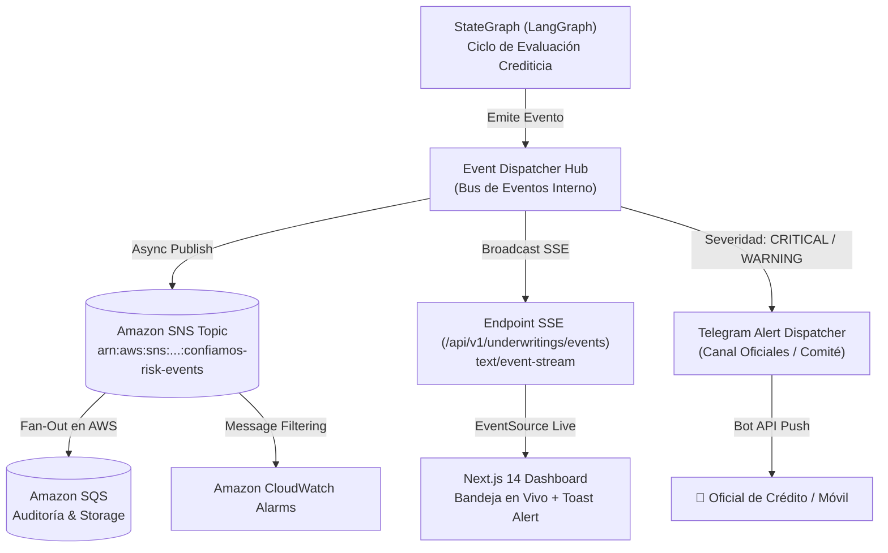
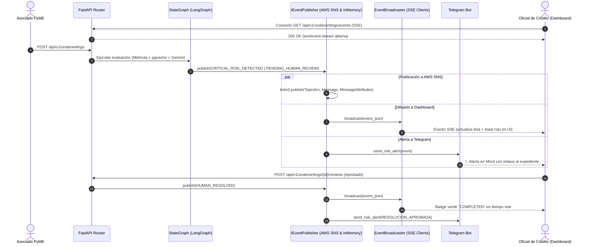

# SPEC-06: Confiamos Risk Engine (CRE) - Notificaciones y Eventos en Tiempo Real con AWS SNS y SSE

- **Estado**: APROBADO
- **Cliente**: Cooperativa Confiamos
- **Stack Tecnológico**: FastAPI (SSE) + Amazon SNS (AWS `boto3`) + Telegram Bot API + Next.js 14 (`EventSource`)
- **Autor**: Antigravity & Jorge Sierra
- **Fecha**: 2026-10-15
- **Versión**: 1.0.0

---

## 1. Contexto de Negocio y Objetivos

### 1.1 Problema
En el modelo actual de **Cooperativa Confiamos**, el procesamiento de solicitudes crediticias es sincrónico desde la perspectiva del oficial:
1. Las bandejas de entrada de créditos en la web requieren recarga manual (*pull polling*) para detectar nuevas radicaciones o actualizaciones.
2. Si un crédito presenta anomalías críticas (ej. DSCR < 1.0 o similitud alta con un crédito en default), los oficiales de cumplimiento no son alertados inmediatamente en sus canales operativos móviles.
3. No existe un bus de eventos empresariales preparado para la integración con sistemas satélites de la cooperativa (auditoría en la nube, pipelines analíticos, archivo documental o notificaciones SMS/email a los asociados).

### 1.2 Objetivo
Implementar una **Arquitectura Orientada a Eventos (EDA)** que:
1. Emita eventos tipados inmutables (`CreditUnderwritingEvent`) en cada hito del ciclo de vida crediticio.
2. Publique dichos eventos en **Amazon SNS (Simple Notification Service)** con atributos de mensaje (`severity`, `event_type`) para fan-out y suscripciones en la nube.
3. Filtre y despache alertas inmediatas a **Telegram** según la criticidad (alertas 🚨 para riesgo alto, ⚠️ para revisión de comité y ✅ para resoluciones).
4. Transmita eventos en vivo al Dashboard Web de oficiales en Next.js 14 mediante **Server-Sent Events (SSE)** con reconexión automática.

### 1.3 Fuera de Alcance (Non-Goals)
- Infraestructura de WebSockets bidireccionales con manejo de presencia (el flujo es unidireccional servidor $\to$ navegador).
- Procesamiento de streams analíticos distribuidos (ej. Apache Kafka o AWS Kinesis) en esta fase.
- Aprobaciones crediticias directas mediante botones inline de Telegram (por política regulatoria, la firma debe realizarse en el Dashboard Web auditado).

---

## 2. Diagramas Arquitectónicos (Mermaid)

### 2.1 Flujo de Eventos Pub/Sub y Notificaciones Multicanal


### 2.2 Diagrama de Secuencia de Eventos en Tiempo Real


---

## 3. Contratos de Interfaz en Python

### 3.1 Modelo de Dominio de Eventos
```python
from enum import StrEnum
from typing import Any, Protocol
from pydantic import BaseModel, Field

class EventSeverity(StrEnum):
    INFO = "INFO"
    WARNING = "WARNING"
    CRITICAL = "CRITICAL"

class CreditEventType(StrEnum):
    APPLICATION_SUBMITTED = "APPLICATION_SUBMITTED"
    METRICS_CALCULATED = "METRICS_CALCULATED"
    CRITICAL_RISK_DETECTED = "CRITICAL_RISK_DETECTED"
    PENDING_HUMAN_REVIEW = "PENDING_HUMAN_REVIEW"
    HUMAN_RESOLVED = "HUMAN_RESOLVED"

class CreditUnderwritingEvent(BaseModel):
    event_id: str
    event_type: CreditEventType
    severity: EventSeverity
    application_id: str
    associated_id: str
    business_name: str
    timestamp: str  # ISO 8601 UTC
    summary: str
    payload: dict[str, Any] = Field(default_factory=dict)
```

### 3.2 Protocolos Desacoplados
```python
class IEventPublisher(Protocol):
    """Protocolo desacoplado para la publicación de eventos empresariales."""
    async def publish_event(self, event: CreditUnderwritingEvent) -> str:
        """Publica el evento en el broker (AWS SNS o InMemory) y retorna el message_id."""
        ...

class IEventBroadcaster(Protocol):
    """Protocolo para suscripción y streaming en tiempo real a clientes conectados."""
    async def subscribe(self):
        """Generador asíncrono de eventos para streaming SSE."""
        ...
    async def broadcast(self, event: CreditUnderwritingEvent) -> None:
        """Difunde el evento a todas las conexiones activas."""
        ...
```

---

## 4. Política de Atributos de Mensaje y Filtrado en AWS SNS

Cada mensaje publicado en Amazon SNS contendrá los siguientes `MessageAttributes` para permitir políticas de suscripción selectivas (*Subscription Filter Policies*):

```json
{
  "severity": {
    "DataType": "String",
    "StringValue": "CRITICAL"
  },
  "event_type": {
    "DataType": "String",
    "StringValue": "CRITICAL_RISK_DETECTED"
  },
  "application_id": {
    "DataType": "String",
    "StringValue": "APP-2D514BAA"
  }
}
```

---

## 5. Criterios de Aceptación y Validación

1. **Publicación y Desacople**:
   - Toda solicitud radicada que presente anomalías críticas (`FLAG_DEFICIT_DSCR`, sobregiros reiterados o precedentes de default) debe emitir un evento con severidad `CRITICAL`.
   - Si no existen credenciales de AWS o `TESTING=true`, el sistema debe operar en memoria con `MockEventPublisher` sin fallar.
2. **Streaming en Vivo vía SSE**:
   - El endpoint `GET /api/v1/underwritings/events` debe emitir eventos en formato estándar `text/event-stream` (`event: credit_update\ndata: {...}\n\n`).
   - El frontend de Next.js debe reflejar la actualización en la bandeja sin necesidad de recargar la página (*F5*).
3. **Alertas en Telegram**:
   - Los eventos de riesgo deben formatearse con el estándar de emojis y enlaces directos al expediente `http://localhost:3000/underwritings/{id}`.
4. **Calidad de Código**:
   - 100% de tests unitarios e integración pasando en < 1.5s, 0 errores de Ruff linter y 0 errores de TypeScript.
