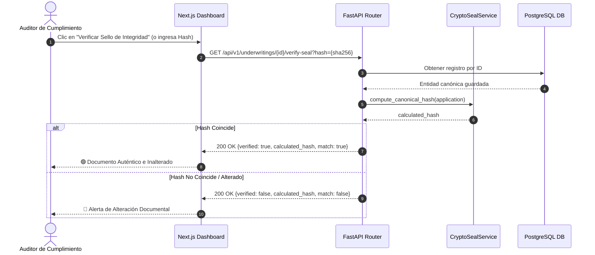

# SPEC-07: Confiamos Risk Engine (CRE) - Exportación Formal de Legajos Crediticios (PDF/Excel) y Sellado de Integridad Criptográfica

- **Estado**: PROPUESTO
- **Cliente**: Cooperativa Confiamos
- **Stack Tecnológico**: Python 3.11+ (`reportlab`, `openpyxl`, `hashlib`), FastAPI (StreamingResponse), Next.js 14 (Tailwind + Lucide)
- **Autor**: Antigravity & Jorge Sierra
- **Fecha**: 2026-10-15
- **Versión**: 1.0.0
- **Issue Asociado**: [#33](https://github.com/jorge-maikel-sierra/confiamos-risk-engine/issues/33)

---

## 1. Contexto de Negocio y Objetivos

### 1.1 Problema
En **Cooperativa Confiamos**, toda operación de crédito PyME o comercial debe ser sometida al **Comité de Crédito** y posteriormente archivada para auditorías de la Superintendencia. Actualmente:
1. El dictamen emitido por el motor de riesgo (métricas determinísticas, veredicto de IA y precedentes de pgvector) reside únicamente en base de datos y en la interfaz web.
2. Los oficiales de crédito deben transcribir manualmente los datos a formatos ofimáticos (Word/Excel) para armar el legajo físico o digital del asociado, generando demoras de hasta 4 horas por solicitud y riesgo de inconsistencias tipográficas.
3. No existe un mecanismo de **no repudio ni verificación de integridad**: si una cifra financiera o recomendación es alterada después de la evaluación, no hay forma rápida de validar que el documento impreso o digital coincida exactamente con el cálculo registrado por el motor.

### 1.2 Objetivo
Construir el subsistema de **Generación de Legajos y Auditoría Criptográfica** que:
1. **Exporte el Dictamen Oficial en PDF bancario institucional**:
   - Diseño formal con membrete de Cooperativa Confiamos, folio único y fecha/hora.
   - Resumen ejecutivo, datos de la empresa, monto solicitado y plazo.
   - Tabla comparativa de métricas determinísticas (DSCR, Liquidez, Runway) con semáforo visual.
   - Precedentes históricos de crédito recuperados semánticamente vía pgvector.
   - Veredicto cualitativo y cuestionario de Due Diligence emitido por Gemini.
   - Espacio formal para firmas de aprobación del Comité de Crédito.
2. **Exporte la Planilla Financiera de Trabajo en Excel (.xlsx)**:
   - Desglose contable de balances, estados de resultados y flujos de caja.
   - Fórmulas financieras vivas en celdas para que los auditores puedan auditar el cálculo del DSCR.
3. **Genere un Sello Criptográfico de Integridad (SHA-256)**:
   - Digest canónico inmutable de los datos de la solicitud, métricas y veredicto.
   - Estampado del hash SHA-256 en el pie de página de cada hoja del PDF y metadatos del archivo.
   - Endpoint de verificación pública que certifique la autenticidad del documento contra la base de datos.
4. **Integre la descarga y verificación en el Dashboard de Next.js**:
   - Acciones de descarga instantánea con feedback visual.
   - Modal o indicador de validación del hash criptográfico.

### 1.3 Fuera de Alcance (Non-Goals)
- Firma digital cualificada con token PKI físico o certificado de entidad certificadora externa (e.g. Certicámara/GSE) en esta fase (se cubre el sellado criptográfico determinístico SHA-256 interno).
- Almacenamiento a largo plazo en S3/Glacier (el renderizado es *on-the-fly* bajo demanda y en memoria; la persistencia canónica ya reside en PostgreSQL).
- Edición online de plantillas PDF.

---

## 2. Diagramas Arquitectónicos (Mermaid)

### 2.1 Flujo de Exportación y Sellado Criptográfico
```mermaid
flowchart TD
    Officer([Oficial de Crédito / Auditor]) -->|GET /underwritings/:id/export/pdf| API[FastAPI Core]
    Officer -->|GET /underwritings/:id/export/excel| API
    Officer -->|GET /underwritings/:id/verify-seal| API

    subgraph Core Engine
        API --> Repo[(PostgreSQL: UnderwritingRepository)]
        Repo -->|Recupera Entidad Completa| Entity[UnderwritingApplication]
        
        Entity --> SealService[CryptoSealService]
        SealService -->|Serialización Canónica + SHA-256| Digest[Hash Criptográfico SHA-256]
        
        Entity & Digest --> PDFGenerator[ReportLab PDF Engine]
        Entity & Digest --> ExcelGenerator[OpenPyXL Workbook Engine]
    end

    PDFGenerator -->|Binary Stream application/pdf| Officer
    ExcelGenerator -->|Binary Stream application/vnd.openxmlformats| Officer
    SealService -->|JSON {valid: true, timestamp, hash}| Officer
```

### 2.2 Diagrama de Secuencia de Verificación de Integridad


---

## 3. Especificación Técnica de Componentes y Modelos

### 3.1 Estructura del Sello Criptográfico (`CryptoSeal`)
Para que el hash sea determinístico y reproducible en cualquier momento o lenguaje:
1. Se extrae un diccionario canónico con las claves fundamentales:
   - `id`: UUID de la solicitud
   - `associated_id`: Identificación del asociado
   - `requested_amount_usd`: Monto solicitado (redondeado a 2 decimales)
   - `term_months`: Plazo en meses
   - `metrics`: `{dscr, current_ratio, runway_months, operating_cash_flow, annual_debt_service}`
   - `recommendation`: APROBADO | APROBADO_CONDICIONADO | RECHAZADO
   - `created_at`: Timestamp ISO-8601 UTC
2. Se serializa con `json.dumps(payload, sort_keys=True, separators=(',', ':'))`.
3. Se aplica `hashlib.sha256(canonical_bytes).hexdigest()`.

```python
class IntegritySeal(BaseModel):
    application_id: str
    sha256_hash: str
    canonical_payload: str
    generated_at: str
    is_valid: bool
```

### 3.2 Servicio de Generación de PDF (`PdfDossierGenerator`)
- **Motor**: `reportlab` (usando `SimpleDocTemplate`, `Table`, `Paragraph`, `Spacer`, `PageTemplate` con canvas footer numerado "Página X de Y").
- **Secciones del PDF**:
  1. **Membrete Corporativo**: Logo / Nombre "COOPERATIVA CONFIAMOS", Tipo de Documento: "DICTAMEN TÉCNICO DE EVALUACIÓN CREDITICIA".
  2. **Ficha del Solicitante**: Razón Social, NIT / ID Asociado, Monto Solicitado en USD, Plazo.
  3. **Matriz de Solvencia Financiera**: Tabla estilizada con DSCR, Liquidez, Runway, Flujo Operativo y Servicio Anual de Deuda.
  4. **Precedentes de Cartera (pgvector)**: Tabla de créditos similares analizados y su resultado (PAGADO / EN_MORA).
  5. **Dictamen de Riesgo e Inteligencia Artificial**: Recomendación formal, puntaje de confianza, resumen ejecutivo, fortalezas y riesgos detectados.
  6. **Cuestionario de Due Diligence**: Lista numerada de preguntas mandatorias para la visita u oficial de crédito.
  7. **Certificado de Firma y Sellado**: Sello criptográfico SHA-256 en fuente monoespaciada + líneas de firma para Presidente del Comité y Oficial de Riesgo.

### 3.3 Servicio de Generación de Excel (`ExcelFinancialGenerator`)
- **Motor**: `openpyxl`.
- **Estructura de Pestañas (Worksheets)**:
  1. `Resumen Ejecutivo`: Carátula con datos generales, veredicto y sello SHA-256.
  2. `Balance y Liquidez`: Activos corrientes, pasivos corrientes, ratio de liquidez con fórmula Excel `=(B4/B5)`.
  3. `Flujo de Caja y Cobertura`: Flujo de caja operativo, servicio de deuda, y fórmula viva para el DSCR `=(B4/B5)` con formato numérico bancario.

### 3.4 Contratos de API REST (FastAPI)

```http
GET /api/v1/underwritings/{id}/export/pdf
Headers: Accept: application/pdf
Response: 200 OK (Stream de bytes con Content-Disposition: attachment; filename="legajo-credito-{id}.pdf")

GET /api/v1/underwritings/{id}/export/excel
Headers: Accept: application/vnd.openxmlformats-officedocument.spreadsheetml.sheet
Response: 200 OK (Stream de bytes con Content-Disposition: attachment; filename="modelo-financiero-{id}.xlsx")

GET /api/v1/underwritings/{id}/verify-seal?hash={sha256}
Response: 200 OK
{
  "application_id": "uuid",
  "expected_hash": "a1b2c3...",
  "provided_hash": "a1b2c3...",
  "is_authentic": true,
  "verified_at": "2026-10-15T18:45:00Z"
}
```

---

## 4. Casos Límite y Manejo de Errores (Edge Cases)

1. **Solicitud en Proceso (Sin Veredicto o Métricas Aún)**:
   - *Comportamiento*: No se genera un dictamen incompleto. Si `ai_verdict` o `metrics` es nulo, el endpoint responde `409 Conflict: La solicitud aún se encuentra en procesamiento y no posee dictamen final emitido`.
2. **Empresa sin Deuda Previa (`annual_debt_service == 0`)**:
   - *Comportamiento*: El PDF y Excel no deben fallar por división por cero; muestran `DSCR: N/A (Sin deuda previa)` y el Excel maneja `=IF(B5=0, "N/A", B4/B5)`.
3. **Caracteres Especiales en Razonamiento o Preguntas de Due Diligence**:
   - *Comportamiento*: El generador PDF debe escapar adecuadamente etiquetas XML/HTML antes de pasarlas a los `Paragraph` de ReportLab para evitar errores de parseo de Flowables.
4. **Verificación de Solicitud Inexistente**:
   - *Comportamiento*: Si el `{id}` no existe, retorna `404 Not Found`.

---

## 5. Criterios de Aceptación (TDD Seams)

* **TEST-01 (Unit - CryptoSeal)**: `compute_canonical_hash` debe generar el mismo hash SHA-256 para dos instancias idénticas sin importar el orden de inserción de campos en los diccionarios auxiliares.
* **TEST-02 (Unit - PDF Generation)**: `PdfDossierGenerator.generate(app)` debe retornar un buffer de bytes no vacío (`bytes`), cuyo encabezado comience con `%PDF-1.` y contenga el texto del asociado y el hash SHA-256.
* **TEST-03 (Unit - Excel Generation)**: `ExcelFinancialGenerator.generate(app)` debe retornar un buffer de bytes válido de Excel (`.xlsx`), con las fórmulas matemáticas `=B4/B5` presentes y evaluables.
* **TEST-04 (API Integration - Endpoints Export)**:
  - `GET /api/v1/underwritings/{id}/export/pdf` retorna `200 OK` con `Content-Type: application/pdf`.
  - `GET /api/v1/underwritings/{id}/export/excel` retorna `200 OK` con `Content-Type: application/vnd.openxmlformats-officedocument.spreadsheetml.sheet`.
* **TEST-05 (API Integration - Verify Seal)**:
  - `GET /api/v1/underwritings/{id}/verify-seal` con hash correcto retorna `is_authentic: true`.
  - Con un solo byte alterado retorna `is_authentic: false`.
* **TEST-06 (Frontend Web)**:
  - Botones "Descargar PDF" y "Descargar Excel" en la página de detalle del crédito.
  - Sello de integridad visible con tooltip de verificación.
