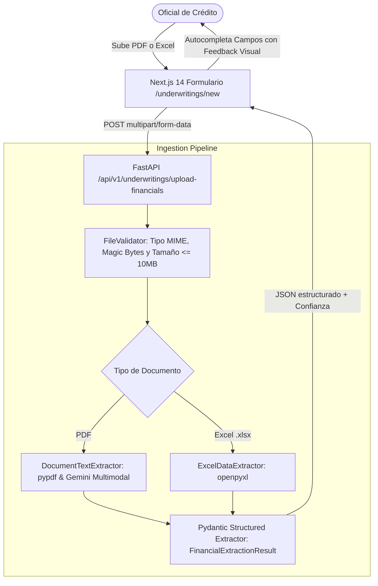
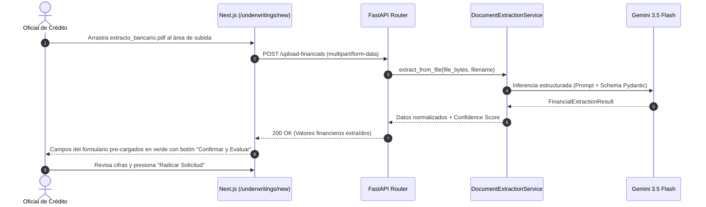

# SPEC-08: Confiamos Risk Engine (CRE) - Ingesta Documental Inteligente y Extracción Estructurada de Estados Financieros

- **Estado**: PROPUESTO
- **Cliente**: Cooperativa Confiamos
- **Stack Tecnológico**: FastAPI (`UploadFile`), Google GenAI SDK (`gemini-3.5-flash`), `pypdf`, `openpyxl`, Next.js 14
- **Autor**: Antigravity & Jorge Sierra
- **Fecha**: 2026-10-15
- **Versión**: 1.0.0
- **Issue Asociado**: [#37](https://github.com/jorge-maikel-sierra/confiamos-risk-engine/issues/37)

---

## 1. Contexto de Negocio y Objetivos

### 1.1 Problema
En el proceso crediticio actual de **Cooperativa Confiamos**, los oficiales de crédito deben digitar a mano en la interfaz web cada una de las cifras financieras del solicitante (flujo de caja operativo, servicio de deuda, activo corriente, pasivo corriente, saldo en bancos y tasa de quema mensual). Esto genera:
1. **Fricción operativa**: Transcribir un balance general y extractos bancarios de 6 meses toma entre 20 y 45 minutos por expediente.
2. **Riesgo de error humano**: Errores en la entrada manual de un cero o coma decimal alteran radicalmente el cálculo del DSCR y ratio de liquidez.
3. **Pérdida de señales no estructuradas**: La entrada manual ignora notas a los estados financieros y conceptos de movimientos bancarios donde suelen esconderse sobregiros y concentración de clientes.

### 1.2 Objetivo
Implementar un subsistema de **Ingesta Documental Inteligente** que:
1. Permita al oficial arrastrar y soltar (*drag-and-drop*) archivos de balances y extractos en formato **PDF o Excel (.xlsx)**.
2. Extraiga de forma estructurada y determinística los campos contables requeridos para el motor de suscripción:
   - `operating_cash_flow` (Flujo de Caja Operativo)
   - `annual_debt_service` (Servicio Anual de Deuda)
   - `current_assets` (Activo Corriente)
   - `current_liabilities` (Pasivo Corriente)
   - `cash_balance` (Saldo en Bancos)
   - `monthly_burn_rate` (Tasa de Quema Mensual)
   - `detected_anomalies` (Detección de sobregiros o alertas en el extracto)
3. Ofrezca un puntaje de confianza (`extraction_confidence` entre 0.0 y 1.0) y un resumen de las fuentes detectadas en el documento.
4. **Precargue automáticamente el formulario web**: El oficial recibe los campos autocompletados en la pantalla de radicación (`/underwritings/new`), permitiendo su validación visual y ajuste humano (*Human-in-the-loop*) antes de enviar la solicitud al motor de riesgo.

### 1.3 Fuera de Alcance (Non-Goals)
- Reconocimiento de texto manuscrito ilegible o fotos borrosas de baja resolución tomadas con celular.
- Procesamiento de archivos comprimidos (.zip/.rar) o documentos protegidos con contraseña bancaria.
- Sustitución de la revisión humana: la IA sugiere y extrae, pero el oficial siempre debe confirmar los valores antes de la radicación final.

---

## 2. Diagramas Arquitectónicos (Mermaid)

### 2.1 Pipeline de Ingesta y Extracción Multimodal


### 2.2 Diagrama de Secuencia de Extracción y Validación Humana


---

## 3. Especificación Técnica de Componentes y Modelos

### 3.1 Esquema de Extracción Financiera (`FinancialExtractionResult`)

```python
class FinancialExtractionResult(BaseModel):
    operating_cash_flow: float = Field(description="Flujo de caja operativo anualizado en USD")
    annual_debt_service: float = Field(description="Servicio anual de la deuda en USD")
    current_assets: float = Field(description="Activo corriente total en USD")
    current_liabilities: float = Field(description="Pasivo corriente total en USD")
    cash_balance: float = Field(description="Saldo disponible en caja y bancos en USD")
    monthly_burn_rate: float = Field(default=0.0, description="Gasto neto operativo mensual en USD")
    confidence_score: float = Field(ge=0.0, le=1.0, description="Nivel de certidumbre de la extracción")
    detected_anomalies: list[str] = Field(default_factory=list, description="Banderas o notas de riesgo halladas")
    extracted_source_name: str = Field(description="Nombre del archivo procesado")
    summary_notes: str = Field(description="Resumen breve de la interpretación contable")
```

### 3.2 Protocolo del Servicio de Extracción (`IDocumentExtractor`)

```python
class IDocumentExtractor(Protocol):
    async def extract_financial_data(
        self,
        file_bytes: bytes,
        filename: str,
    ) -> FinancialExtractionResult:
        """Extrae las métricas financieras desde un archivo PDF o Excel."""
        ...
```

### 3.3 Implementaciones:
1. **`GeminiDocumentExtractor`**:
   - Para PDFs: extrae el texto del documento o envía los bytes del archivo a `gemini-3.5-flash` con esquema JSON de salida forzado en `FinancialExtractionResult`.
2. **`ExcelDocumentExtractor`**:
   - Para planillas `.xlsx`: escanea filas y encabezados contables ("Activo", "Pasivo", "EBITDA", "Flujo", "Deuda") y suma celdas numéricas.
3. **`MockDocumentExtractor`**:
   - Implementación en memoria para pruebas automatizadas offline y modo de contingencia.

### 3.4 Contrato de API REST (FastAPI)

```http
POST /api/v1/underwritings/upload-financials
Content-Type: multipart/form-data

Form fields:
- file: binary (PDF o XLSX)

Response 200 OK:
{
  "operating_cash_flow": 85000.0,
  "annual_debt_service": 52400.0,
  "current_assets": 210000.0,
  "current_liabilities": 100000.0,
  "cash_balance": 45000.0,
  "monthly_burn_rate": 0.0,
  "confidence_score": 0.95,
  "detected_anomalies": [],
  "extracted_source_name": "balance_general_2026.pdf",
  "summary_notes": "Extracción exitosa desde balance clasificado a corte de diciembre."
}
```

---

## 4. Casos Límite y Manejo de Errores (Edge Cases)

1. **Archivo no soportado (e.g. .exe, .zip, .docx)**:
   - *Comportamiento*: HTTP `415 Unsupported Media Type` con mensaje claro de error.
2. **Archivo superior a 10 MB**:
   - *Comportamiento*: HTTP `413 Payload Too Large`.
3. **Archivo PDF corrupto o sin texto (escaneo vacío sin OCR)**:
   - *Comportamiento*: HTTP `422 Unprocessable Entity` indicando "El archivo no contiene texto legible ni tablas contables detectables".
4. **Falla de API o cuota de Gemini en la extracción**:
   - *Comportamiento*: Fallback resiliente al extractor heurístico/mock con advertencia de confianza reducida (`confidence_score = 0.50`).

---

## 5. Criterios de Aceptación (TDD Seams)

* **TEST-01 (Unit - File Validation)**: `validate_uploaded_file(filename, size)` debe aceptar `.pdf` y `.xlsx` y rechazar extensiones no autorizadas o tamaños > 10MB.
* **TEST-02 (Unit - Mock Extractor)**: `MockDocumentExtractor.extract_financial_data` debe devolver un `FinancialExtractionResult` válido con todos los tipos numéricos correctos.
* **TEST-03 (Unit - Excel Extractor)**: `ExcelDocumentExtractor` debe procesar un archivo `.xlsx` en memoria y extraer los activos y pasivos corrientes correctos.
* **TEST-04 (Integration - API Endpoint Upload)**:
  - `POST /api/v1/underwritings/upload-financials` con un archivo PDF válido retorna `200 OK` con el esquema JSON esperado.
  - Subir un archivo `.txt` no permitido retorna `415 Unsupported Media Type`.
* **TEST-05 (Frontend Web)**:
  - Zona de arrastrar y soltar presente en `/underwritings/new`.
  - Al completar la subida, los campos de montos y balances del formulario se actualizan automáticamente.
