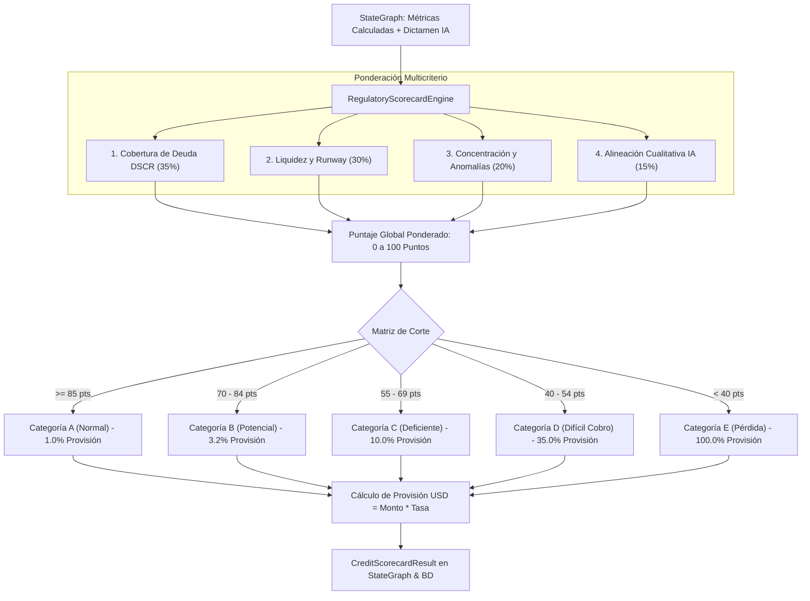
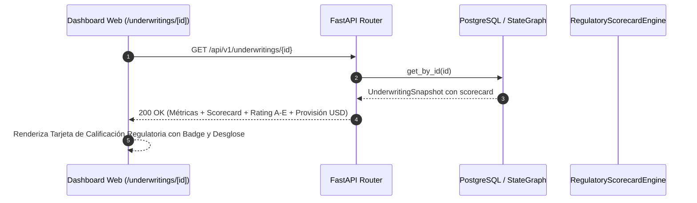

# SPEC-09: Confiamos Risk Engine (CRE) - Matriz de Scoring Crediticio Regulatorio (Rating A–E) y Provisiones Contables

- **Estado**: PROPUESTO
- **Cliente**: Cooperativa Confiamos
- **Stack Tecnológico**: Python 3.14, Pydantic v2, FastAPI, LangGraph, Next.js 14, TailwindCSS
- **Autor**: Antigravity & Jorge Sierra
- **Fecha**: 2026-10-15
- **Versión**: 1.0.0
- **Issue Asociado**: [#41](https://github.com/jorge-maikel-sierra/confiamos-risk-engine/issues/41)

---

## 1. Contexto de Negocio y Objetivos

### 1.1 Problema
En el sector cooperativo y financiero, la suscripción crediticia no culmina con una simple recomendación binaria de "Aprobado" o "Rechazado". Por mandato de la **Superintendencia de Economía Solidaria y Vigilancia Financiera**, toda entidad crediticia debe:
1. **Asignar una Calificación de Riesgo Estandarizada (Bandas A, B, C, D, E)** a cada solicitud aprobada o evaluada.
2. **Estimar la Provisión Patrimonial Requerida (Gasto por Pérdida Esperada)**: La cooperativa debe reservar de su patrimonio un porcentaje del monto colocado para cubrir eventuales impagos. Una cartera con alto porcentaje en categorías C, D o E erosiona directamente el margen de solvencia de la cooperativa.
3. **Justificar objetivamente la calificación**: Evitar discrecionalidades subjetivas de los oficiales de crédito mediante un algoritmo de scoring multicriterio transparente, determinístico y auditable.

### 1.2 Objetivo
Implementar en **Confiamos Risk Engine** el subsistema de **Scoring Crediticio Regulatorio**:
1. Ejecutar una **Scorecard Multicriterio Ponderada** (0 a 100 puntos) combinando métricas cuantitativas duras, concentración comercial y el dictamen cualitativo de la IA.
2. Mapear el puntaje total a las **5 Categorías Regulatorias Oficiales**:
   - **Categoría A (Riesgo Normal)**: 85 – 100 puntos. Provisión: 1.0%
   - **Categoría B (Riesgo Aceptable con Potencial)**: 70 – 84 puntos. Provisión: 3.2%
   - **Categoría C (Riesgo Deficiente)**: 55 – 69 puntos. Provisión: 10.0%
   - **Categoría D (Riesgo Significativo / Difícil Cobro)**: 40 – 54 puntos. Provisión: 35.0%
   - **Categoría E (Riesgo de Pérdida / Irrecuperable)**: < 40 puntos. Provisión: 100.0%
3. Calcular en tiempo real el monto exacto de la **Provisión Estimada en USD** según el monto solicitado.
4. Integrar el scoring en el `StateGraph` de LangGraph, en la persistencia PostgreSQL y en el expediente del oficial en el Frontend web ([`/underwritings/[id]`](file:///Users/jorgesierra/Documents/dev/confiamos-risk-engine/apps/web/src/app/underwritings/[id]/page.tsx)).

### 1.3 Fuera de Alcance (Non-Goals)
- Modelos predictivos de machine learning tipo "caja negra" no auditables por reguladores (se exige explicabilidad matemática punto por punto).
- Contabilización automática en el core contable de la cooperativa (la provisión calculada se expone como indicador normativo para el comité).

---

## 2. Diagramas Arquitectónicos (Mermaid)

### 2.1 Pipeline de Evaluación y Scoring Multicriterio


### 2.2 Integración en el Expediente Crediticio


---

## 3. Especificación Matemática y Modelos de Dominio

### 3.1 Ponderación y Reglas de la Scorecard (0 – 100 Pts)

| Factor | Peso | Regla de Puntuación |
|---|---|---|
| **DSCR (Cobertura Deuda)** | **35%** | $\ge 1.50 \to 100$ pts<br>$[1.30, 1.50) \to 80$ pts<br>$[1.15, 1.30) \to 60$ pts<br>$[1.00, 1.15) \to 40$ pts<br>$< 1.00 \to 0$ pts |
| **Liquidez y Runway** | **30%** | $\text{Current Ratio} \ge 1.50 \land \text{Runway} \ge 6 \text{ m} \to 100$ pts<br>$\text{Current Ratio} \ge 1.20 \land \text{Runway} \ge 3 \text{ m} \to 80$ pts<br>$\text{Current Ratio} \ge 1.00 \to 60$ pts<br>$\text{Current Ratio} < 1.00 \to 20$ pts |
| **Concentración y Solvencia Operativa** | **20%** | Cliente mayor $\le 25\% \land 0$ sobregiros $\to 100$ pts<br>Cliente mayor $\le 50\% \land \le 2$ sobregiros $\to 70$ pts<br>Cliente mayor $> 50\% \lor > 2$ sobregiros $\to 30$ pts<br>*Penalización adicional*: $-15$ pts por cada anomalía crítica en el extracto |
| **Alineación Dictamen IA (Gemini)** | **15%** | APROBADO $\to 100$ pts<br>APROBADO_CONDICIONADO $\to 60$ pts<br>RECHAZADO $\to 0$ pts |

$$\text{Puntaje Total} = 0.35 \times S_{\text{DSCR}} + 0.30 \times S_{\text{Liquidez}} + 0.20 \times S_{\text{Concentración}} + 0.15 \times S_{\text{IA}}$$

### 3.2 Esquema de Datos Pydantic (`CreditScorecardResult`)

```python
from enum import Enum
from pydantic import BaseModel, Field

class RiskRatingCategory(str, Enum):
    A = "A"  # Riesgo Normal
    B = "B"  # Riesgo Aceptable con Potencial
    C = "C"  # Riesgo Deficiente / Apreciable
    D = "D"  # Riesgo Significativo / Difícil Cobro
    E = "E"  # Riesgo de Pérdida / Irrecuperable

class ScorecardBreakdown(BaseModel):
    dscr_score: float = Field(ge=0.0, le=100.0)
    liquidity_score: float = Field(ge=0.0, le=100.0)
    concentration_score: float = Field(ge=0.0, le=100.0)
    ai_alignment_score: float = Field(ge=0.0, le=100.0)

class CreditScorecardResult(BaseModel):
    total_score: float = Field(ge=0.0, le=100.0, description="Puntuación total ponderada (0-100)")
    rating_category: RiskRatingCategory = Field(description="Calificación regulatoria oficial (A a E)")
    category_title: str = Field(description="Nombre descriptivo de la categoría regulatoria")
    provision_percentage: float = Field(description="Porcentaje de provisión patrimonial exigida")
    estimated_provision_usd: float = Field(description="Monto en USD de la provisión contable requerida")
    breakdown: ScorecardBreakdown = Field(description="Desglose por componente evaluado")
    regulatory_justification: str = Field(description="Dictamen de sustentación para el comité de crédito")
```

---

## 4. Casos Límite y Manejo de Errores (Edge Cases)

1. **Solicitud sin deudas previas (`is_debt_free = True` o `annual_debt_service = 0`)**:
   - *Comportamiento*: El componente DSCR no divide entre cero; asigna automáticamente el puntaje máximo ($100$ pts) con justificación "Solicitante sin endeudamiento financiero preexistente".
2. **Empresa sin quema mensual de caja (`monthly_burn_rate = 0`)**:
   - *Comportamiento*: El runway no se calcula infinito; se evalúa la suficiencia del ratio corriente con un tope seguro.
3. **Puntuación en frontera exacta (ejemplo: 70.0 puntos)**:
   - *Comportamiento*: Inclusión cerrada en el límite inferior: 70.0 califica en Categoría B; 85.0 califica en Categoría A.

---

## 5. Criterios de Aceptación (TDD Seams)

* **TEST-01 (Unit - DSCR Score Calculation)**:
  - Evalúa valores escalonados de DSCR ($> 1.50 \to 100$, $1.35 \to 80$, $1.20 \to 60$, $< 1.0 \to 0$, servicio de deuda $0 \to 100$).
* **TEST-02 (Unit - Liquidity & Runway Score)**:
  - Evalúa combinaciones de ratio corriente y meses de runway.
* **TEST-03 (Unit - Total Scorecard & Rating Cutoffs)**:
  - Verifica que puntajes $\ge 85$ asignen categoría `A` con $1.0\%$ de provisión, y puntajes $< 40$ asignen `E` con $100\%$ de provisión.
* **TEST-04 (Integration - StateGraph Node)**:
  - El nodo `calculate_scorecard_node` en LangGraph enriquece el estado con `CreditScorecardResult` y persiste en base de datos.
* **TEST-05 (Frontend Web)**:
  - La pantalla [`/underwritings/[id]`](file:///Users/jorgesierra/Documents/dev/confiamos-risk-engine/apps/web/src/app/underwritings/[id]/page.tsx) renderiza la tarjeta de Calificación Regulatoria (Badge A-E, Score y Provisión en USD).
