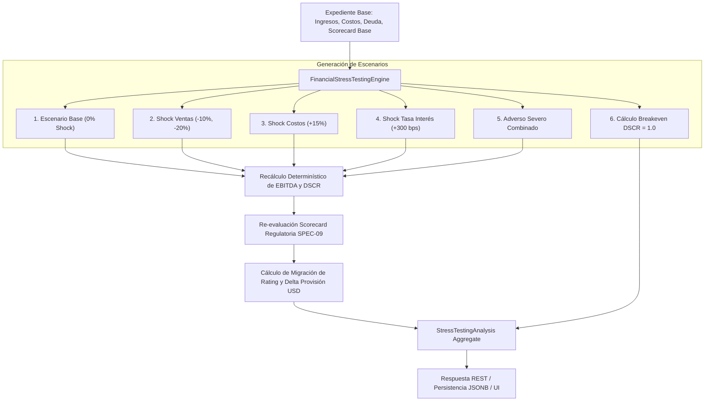
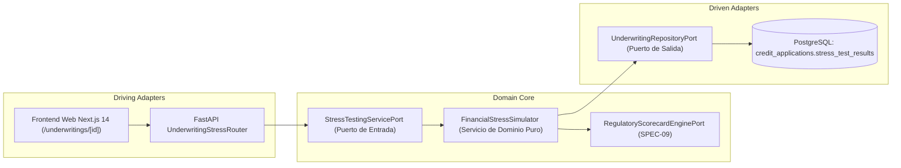

# SPEC-10: Confiamos Risk Engine (CRE) - Simulador de Pruebas de Estrés Financiero (Stress Testing & Análisis de Sensibilidad)

- **Estado**: PROPUESTO
- **Cliente**: Cooperativa Confiamos
- **Stack Tecnológico**: Python 3.14, Pydantic v2, FastAPI, LangGraph, Next.js 14, TailwindCSS
- **Autor**: Antigravity & Jorge Sierra
- **Fecha**: 2026-10-20
- **Versión**: 1.0.0
- **Issue Asociado**: [#48](https://github.com/jorge-maikel-sierra/confiamos-risk-engine/issues/48)

---

## 1. Contexto de Negocio y Objetivos

### 1.1 Problema
En la suscripción de créditos para micro y pequeñas empresas asociadas a **Cooperativa Confiamos**, evaluar únicamente la fotografía financiera estática del último balance o estado de resultados resulta insuficiente y peligroso. 

Bajo la normativa prudencial de la **Superintendencia de Economía Solidaria y Reguladores Financieros (Basilea / SARO)**, una cooperativa debe garantizar la resiliencia de su cartera crediticia frente a perturbaciones macroeconómicas y shocks operativos adversos. Un asociado PyME que hoy califica en **Categoría A (Riesgo Normal)** puede volverse insolvente rápidamente si experimenta:
1. Una contracción de ingresos por caída de demanda o pérdida de un cliente relevante (-10% a -30%).
2. Un incremento de costos operativos derivado de inflación o suba en materias primas (+10% a +20%).
3. Un encarecimiento del servicio de la deuda por subas en la tasa de interés de referencia (+200 a +500 bps).

Aprobar operaciones sin simular estos escenarios genera un riesgo oculto: el deterioro súbito de la calificación migra los créditos a categorías C, D o E, obligando a la cooperativa a inmovilizar capital propio de forma imprevista para constituir provisiones contables.

### 1.2 Objetivo
Implementar en **Confiamos Risk Engine** el subsistema de **Stress Testing & Análisis de Sensibilidad Financiera**:
1. Proveer un motor de cálculo determinístico (`FinancialStressTestingEngine`) bajo Arquitectura Hexagonal pura que aplique shocks paramétricos sobre los flujos del solicitante.
2. Evaluar un set canónico de escenarios de estrés:
   - **Escenario Base**: Parámetros originales del expediente sin shock.
   - **Shock Leve de Ventas**: Caída del 10% en ingresos operativos.
   - **Shock Moderado de Ventas**: Caída del 20% en ingresos operativos.
   - **Shock de Costos Operativos**: Incremento del 15% en costos y gastos.
   - **Shock de Tasa de Interés**: Alza de +300 bps (+3.0%) en la tasa anual del crédito.
   - **Escenario Adverso Severo Combinado (Stagflation / Crisis)**: Caída del 20% en ventas + Aumento del 10% en costos + Suba de +300 bps en tasa.
3. Recalcular dinámicamente las métricas de solvencia (EBITDA proyectado, nuevo DSCR, Runway y Liquidez) para cada escenario.
4. Re-ejecutar la **Scorecard Regulatoria (SPEC-09)** para proyectar la migración de calificación (e.g., A $\to$ C) y cuantificar el **Delta de Provisión Patrimonial en USD** (Provisión Estresada vs Provisión Base).
5. Calcular el **Punto de Quiebre de Ventas (Breakeven Sales Drop)**: Porcentaje exacto de caída de ingresos que el asociado puede tolerar antes de que su DSCR caiga por debajo de $1.00$ (momento en que el flujo no cubre la deuda).
6. Exponer la funcionalidad mediante endpoints REST conformes a RFC 9110 / RFC 7807 y ofrecer un simulador interactivo en el frontend web con sliders de estrés en [`/underwritings/[id]`](file:///Users/jorgesierra/Documents/dev/confiamos-risk-engine/apps/web/src/app/underwritings/[id]/page.tsx).

### 1.3 Fuera de Alcance (Non-Goals)
- Modelos estocásticos de Monte Carlo en tiempo real que degraden la latencia de la API (se utiliza modelado de sensibilidad determinístico y stress testing por escenarios normativos).
- Modificación directa del dictamen crediticio base sin intervención del oficial de crédito (el estrés actúa como soporte de decisión y test de resiliencia).

---

## 2. Diagramas Arquitectónicos (Mermaid)

### 2.1 Flujo de Ejecución del Simulador de Estrés


### 2.2 Arquitectura Hexagonal (Ports & Adapters)


---

## 3. Especificación Matemática y Modelos de Dominio

### 3.1 Formulación Matemática Determinística

#### 1. Choque de Ingresos y Costos Operativos
Dados los ingresos brutos anuales $R$, el costo total anual $C$, el porcentaje de choque de ventas $\Delta_{\text{rev}} \in [0, 1)$ y el porcentaje de inflación de costos $\Delta_{\text{cost}} \ge 0$:
$$R_{\text{stress}} = R \times (1 - \Delta_{\text{rev}})$$
$$C_{\text{stress}} = C \times (1 + \Delta_{\text{cost}})$$
$$\text{EBITDA}_{\text{stress}} = R_{\text{stress}} - C_{\text{stress}}$$

#### 2. Choque de Tasa de Interés en el Servicio de la Deuda
Dado el servicio anual de la deuda actual $\text{DebtService}$, el monto del crédito $P$, el plazo en meses $n$, la tasa nominal anual base $i_{\text{base}}$ y el shock de tasa $\Delta_{\text{rate\_bps}}$ expresado en puntos básicos ($100 \text{ bps} = 0.01$):
$$i_{\text{stress}} = i_{\text{base}} + \frac{\Delta_{\text{rate\_bps}}}{10000}$$
El recálculo de la cuota amortizable o el factor de servicio financiero sobre la deuda total se proyecta como:
$$\text{DebtService}_{\text{stress}} = \text{DebtService} + P \times \left(\frac{\Delta_{\text{rate\_bps}}}{10000}\right)$$

#### 3. Recálculo del Coeficiente DSCR Estresado
$$\text{DSCR}_{\text{stress}} = \begin{cases} 
\frac{\text{EBITDA}_{\text{stress}}}{\text{DebtService}_{\text{stress}}} & \text{si } \text{DebtService}_{\text{stress}} > 0 \\
100.0 & \text{si } \text{DebtService}_{\text{stress}} = 0 \text{ y } \text{EBITDA}_{\text{stress}} > 0 \\
0.0 & \text{si } \text{EBITDA}_{\text{stress}} \le 0
\end{cases}$$

#### 4. Punto de Quiebre de Tolerancia Máxima (Breakeven Sales Drop $\Delta^*$)
Determina la caída porcentual en ventas exacta que reduce el DSCR exactamente a $1.00$:
$$\text{DSCR} = 1.00 \iff \text{EBITDA} = \text{DebtService}$$
$$R \times (1 - \Delta^*) - C = \text{DebtService}$$
$$\Delta^* = 1 - \frac{C + \text{DebtService}}{R}$$
- Si $\Delta^* \le 0$: La empresa ya opera por debajo de la cobertura mínima o en insolvencia técnica (tolerancia $0\%$).
- Si $\Delta^* > 0$: Expresa el margen de seguridad de ingresos del deudor frente a contingencias.

---

### 3.2 Esquema de Datos de Dominio (Pydantic v2)

```python
from enum import Enum
from pydantic import BaseModel, Field

class StressScenarioType(str, Enum):
    BASE = "BASE"
    SALES_SHOCK_MILD = "SALES_SHOCK_MILD"         # -10% ventas
    SALES_SHOCK_MODERATE = "SALES_SHOCK_MODERATE" # -20% ventas
    COST_SHOCK = "COST_SHOCK"                     # +15% costos operativos
    RATE_SHOCK = "RATE_SHOCK"                     # +300 bps en tasa
    COMBINED_SEVERE = "COMBINED_SEVERE"           # -20% ventas, +10% costos, +300 bps
    CUSTOM = "CUSTOM"                             # Parámetros definidos por el usuario

class StressParameters(BaseModel):
    sales_shock_pct: float = Field(default=0.0, ge=0.0, le=0.90, description="Caída porcentual en ventas (0.0 a 0.90)")
    opex_shock_pct: float = Field(default=0.0, ge=0.0, le=2.00, description="Incremento porcentual en costos operativos (0.0 a 2.00)")
    interest_rate_shock_bps: int = Field(default=0, ge=0, le=2000, description="Incremento en tasa de interés en bps (e.g. 300 = +3.0%)")

class ScenarioStressResult(BaseModel):
    scenario_type: StressScenarioType
    scenario_name: str
    description: str
    stressed_ebitda: float
    stressed_debt_service: float
    stressed_dscr: float
    base_rating: str  # Calificación original (A a E)
    stressed_rating: str  # Nueva calificación simulada (A a E)
    rating_downgraded: bool
    base_provision_usd: float
    stressed_provision_usd: float
    delta_provision_usd: float
    is_solvent: bool = Field(description="True si DSCR >= 1.0 y EBITDA > 0")

class StressTestingAnalysis(BaseModel):
    application_id: str
    executed_at: str
    base_scenario: ScenarioStressResult
    scenarios: list[ScenarioStressResult]
    breakeven_sales_drop_pct: float = Field(description="Caída máxima de ventas soportada antes de DSCR < 1.0")
    breakeven_tolerable: bool = Field(description="True si tolera al menos 15% de caída sin insolvencia")
    resilience_summary: str = Field(description="Resumen cualitativo de resiliencia financiera")
```

---

## 4. Contrato de API REST (RFC 9110 / RFC 7807)

### 4.1 Ejecutar o Simular Pruebas de Estrés
- **Ruta**: `POST /api/v1/underwritings/{id}/stress-test`
- **Headers**: `Content-Type: application/json`
- **Request Body (Opcional - para escenario custom)**:
```json
{
  "custom_scenario": {
    "sales_shock_pct": 0.25,
    "opex_shock_pct": 0.10,
    "interest_rate_shock_bps": 350
  }
}
```
- **Respuesta 200 OK**: Objeto `StressTestingAnalysis` con el escenario base, los 5 escenarios canónicos y el custom (si fue provisto).
- **Respuesta 404 Not Found (RFC 7807 Problem Details)**:
```json
{
  "type": "https://errors.confiamos.coop/underwriting/not-found",
  "title": "Underwriting Application Not Found",
  "status": 404,
  "detail": "No credit application found with ID 123e4567-e89b-12d3-a456-426614174000",
  "instance": "/api/v1/underwritings/123e4567-e89b-12d3-a456-426614174000/stress-test"
}
```

### 4.2 Consultar Último Análisis de Estrés Persistido
- **Ruta**: `GET /api/v1/underwritings/{id}/stress-test`
- **Respuesta 200 OK**: Retorna el `StressTestingAnalysis` previamente persistido.
- **Respuesta 404 Not Found**: Si la solicitud no existe o aún no cuenta con un análisis de estrés calculado.

---

## 5. Casos Límite y Manejo de Errores (Edge Cases)

1. **Solicitante sin endeudamiento financiero preexistente**:
   - $\text{DebtService} = 0$: Un incremento de tasa en bps sobre pasivos preexistentes no altera el servicio base. El shock solo aplica si la cuota del nuevo crédito solicitado está proyectada. El simulador asigna $\text{DSCR} = 100.0$ y previene división entre cero.
2. **Empresa con margen operativo negativo preexistente ($R - C \le 0$)**:
   - El punto de quiebre $\Delta^*$ resulta negativo ($\le 0$). El simulador retorna $\Delta^* = 0.0\%$, marca `is_solvent = False` y genera la advertencia `"Insolvencia operativa preexistente en balance base"`.
3. **Pérdida superior al 100% de ingresos**:
   - El validador Pydantic restringe $\Delta_{\text{rev}} \le 0.90$. Si el usuario introduce valores superiores, se rechaza con error 422 Unprocessable Content.
4. **EBITDA Estresado Negativo**:
   - Si los costos superan a los ingresos estresados, $\text{DSCR}_{\text{stress}}$ se trunca en $0.00$, la scorecard asigna automáticamente categoría `E` (100% provisión) y `is_solvent` se marca en `False`.

---

## 6. Criterios de Aceptación (TDD Seams)

* **TEST-01 (Unit - Sales Shock Calculation)**:
  - Verificar que una reducción del $20\%$ de ingresos en una PyME con $100,000 USD de ventas y $70,000 USD de costos reduzca el EBITDA de $30,000 a $10,000 USD y contraiga el DSCR según la deuda activa.
* **TEST-02 (Unit - Interest Rate Shock on Debt Service)**:
  - Verificar que un incremento de $+300$ bps aumente el costo financiero proyectado y reduzca proporcionalmente el DSCR.
* **TEST-03 (Unit - Combined Severe Scenario & Rating Downgrade)**:
  - Evaluar un expediente con Rating Base `A` bajo el escenario adverso severo y confirmar la migración de calificación (e.g., A $\to$ C o D) junto con el incremento exacto de provisión en USD.
* **TEST-04 (Unit - Breakeven Sales Drop)**:
  - Verificar el cálculo analítico exacto de la caída máxima tolerable de ventas para que $\text{DSCR} = 1.00$.
* **TEST-05 (Integration - REST Endpoint POST /underwritings/{id}/stress-test)**:
  - Validar que la API responda con HTTP 200 y el contrato `StressTestingAnalysis`, persistiendo los resultados en la base de datos PostgreSQL.
* **TEST-06 (Frontend Web - Interactive Stress Simulator UI)**:
  - Validar que el componente de Stress Testing en [`/underwritings/[id]`](file:///Users/jorgesierra/Documents/dev/confiamos-risk-engine/apps/web/src/app/underwritings/[id]/page.tsx) renderice controles interactivos (sliders), tabla comparativa de escenarios y badges de migración de calificación.
