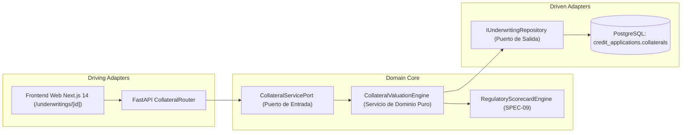

# SPEC-11: Confiamos Risk Engine (CRE) - Motor de Valuación de Garantías, Cálculo de LTV y Provisiones Netas por Mitigantes Admisibles

- **Estado**: PROPUESTO
- **Cliente**: Cooperativa Confiamos
- **Stack Tecnológico**: Python 3.14, Pydantic v2, FastAPI, LangGraph, Next.js 14, TailwindCSS
- **Autor**: Antigravity & Jorge Sierra
- **Fecha**: 2026-10-23
- **Versión**: 1.0.0
- **Issue Asociado**: [#52](https://github.com/jorge-maikel-sierra/confiamos-risk-engine/issues/52)

---

## 1. Contexto de Negocio y Objetivos

### 1.1 Problema
En la suscripción crediticia para micro y pequeñas empresas asociadas a **Cooperativa Confiamos**, la evaluación de los flujos de caja y ratios de cobertura (DSCR, Liquidez - SPEC-01) constituye la **primera fuente de pago**. No obstante, para créditos de mediano y largo plazo o asociados con calificaciones de riesgo con potencial de deterioro (Categorías B, C o D - SPEC-09), la cooperativa requiere constituir **segundas fuentes de pago**: garantías y colaterales reales idóneos.

Bajo la normativa prudencial de la **Superintendencia de Economía Solidaria y Vigilancia Financiera (SES / Basilea)**:
1. **La Provisión Bruta inmoviliza capital en exceso**: Una cooperativa que calcula provisiones exclusivamente sobre el capital colocado sin descontar garantías admisibles sufre una erosión severa de su margen de solvencia patrimonial.
2. **Los avalúos comerciales no pueden tomarse al 100%**: En procesos de remate o liquidación judicial forzosa, los activos sufren demoras legales, gastos periciales y depreciación de mercado. La regulación exige aplicar **castigos normativos de liquidez (Haircuts)** sobre el avalúo pericial.
3. **Falta de estandarización en el indicador Loan-to-Value (LTV)**: Otorgar créditos con LTV superiores al $70\%$ o $80\%$ sobre bienes raíces o maquinaria incrementa exponencialmente la severidad de pérdida ante impago (Loss Given Default - LGD).

### 1.2 Objetivo
Implementar en **Confiamos Risk Engine** el subsistema de **Valuación de Garantías, LTV y Deducción de Provisiones Netas**:
1. Construir un motor de cálculo determinístico (`CollateralValuationEngine`) bajo Arquitectura Hexagonal pura.
2. Definir una matriz de **Garantías Admisibles** y **Haircuts Regulatorios**:
   - **Depósito a Plazo / CDAT Pignorado**: Haircut $5\%$ (Activo líquido en custodia directa de la cooperativa).
   - **Garantía Institucional FNG / Fondo de Garantías**: Haircut $10\%$ (Afianzamiento institucional soberano sobre el porcentaje respaldado).
   - **Hipoteca Inmueble Urbano (Vivienda / Local)**: Haircut $20\%$ (Baja volatilidad, alta demanda).
   - **Hipoteca Inmueble Rural / Bodega / Terreno**: Haircut $35\%$ (Menor liquidez de remate).
   - **Prenda Vehicular (Flota Comercial / Transporte)**: Haircut $30\%$ (Depreciación anual acelerada).
   - **Prenda Maquinaria y Equipo Industrial**: Haircut $40\%$ (Especialización técnica y costo de desmontaje).
   - **Pagaré con Aval Solidario / Fianza Personal**: Haircut $50\%$ (*Garantía no admisible para deducción de provisión contable*, pero evaluada como mitigante cualitativo para comité).
3. Calcular analíticamente:
   - **Valor Admisible Ponderado ($V_{\text{adm}}$)** por activo: $\text{Avalúo} \times (1 - \text{Haircut})$.
   - **Ratio Loan-to-Value ($\text{LTV}$)**: $\frac{\text{Monto Solicitado}}{\sum \text{Avalúo Comercial}} \times 100\%$.
   - **Cobertura de Garantía (Collateral Coverage Ratio - $\text{CCR}$)**: $\frac{\sum V_{\text{adm}}}{\text{Monto Solicitado}} \times 100\%$.
   - **Exposición Neta al Incumplimiento ($\text{EAD}_{\text{neta}}$)**: $\max(0, \text{Monto Solicitado} - \sum V_{\text{adm}})$.
   - **Provisión Neta Requerida en USD**: $\text{EAD}_{\text{neta}} \times \left(\frac{\text{Tasa Provisión \% (SPEC-09)}}{100}\right)$.
   - **Ahorro Patrimonial de Capital (Capital Relief)**: $\text{Provisión Bruta} - \text{Provisión Neta}$.
4. Exponer endpoints REST (RFC 9110 / RFC 7807) para registrar y consultar colaterales (`POST` / `GET` `/api/v1/underwritings/{id}/collaterals`).
5. Proveer un componente visual interactivo en el frontend Next.js 14 ([`/underwritings/[id]`](file:///Users/jorgesierra/Documents/dev/confiamos-risk-engine/apps/web/src/app/underwritings/[id]/page.tsx)) con desglose de colaterales, barra de LTV y comparativo de provisión bruta vs neta.

### 1.3 Fuera de Alcance (Non-Goals)
- Trámites de escrituración o registro notarial externo (se modela la valuación pericial y admisibilidad jurídica).
- Liquidación judicial automática o subastas de bienes en mora.

---

## 2. Diagramas Arquitectónicos (Mermaid)

### 2.1 Flujo de Valuación y Mitigación de Provisiones
```mermaid
flowchart TD
    App[Expediente Crediticio: Monto Solicitado + Rating SPEC-09] --> Engine[CollateralValuationEngine]
    Items[Lista de Colaterales: Avalúos Comerciales + Tipos de Bien] --> Engine

    subgraph Valuación y Ponderación Normativa
        Engine --> HaircutMap{Matriz de Haircuts}
        HaircutMap -->|CDAT / Efectivo| H5["Haircut 5%"]
        HaircutMap -->|Garantía FNG| H10["Haircut 10%"]
        HaircutMap -->|Hipoteca Urbana| H20["Haircut 20%"]
        HaircutMap -->|Prenda Vehicular| H30["Haircut 30%"]
        HaircutMap -->|Hipoteca Rural| H35["Haircut 35%"]
        HaircutMap -->|Prenda Maquinaria| H40["Haircut 40%"]
        HaircutMap -->|Aval Personal| H50["Haircut 50% (No Deducible)"]
    end

    H5 & H10 & H20 & H30 & H35 & H40 --> AdmissibleTotal[Suma de Colaterales Admisibles V_adm]
    
    AdmissibleTotal --> LTVCalc[Cálculo de LTV = Monto / Avalúo Total]
    AdmissibleTotal --> CCRCalc[Cálculo de Cobertura CCR = V_adm / Monto]
    AdmissibleTotal --> NetEAD[Exposición Neta EAD = max(0, Monto - V_adm)]
    
    NetEAD --> NetProvision[Provisión Neta USD = EAD * Tasa Rating]
    NetProvision --> Relief[Ahorro de Capital USD = Provisión Bruta - Provisión Neta]
    
    Relief & LTVCalc & CCRCalc --> Output[UnderwritingCollateralAnalysis en BD & REST API]
```

### 2.2 Arquitectura Hexagonal (Ports & Adapters)


---

## 3. Especificación Matemática y Modelos de Dominio

### 3.1 Formulación Matemática

#### 1. Valor Admisible Ponderado por Colateral
Para cada garantía $k$ con avalúo comercial $A_k$ y factor de castigo regulatorio $h_k \in [0, 1]$:
$$V_{\text{adm}, k} = \begin{cases}
A_k \times (1 - h_k) & \text{si la garantía es admisible normativamente} \\
0.0 & \text{si es garantía no admisible para provisión (ej. aval personal)}
\end{cases}$$

#### 2. Ratio Loan-to-Value (LTV)
$$\text{LTV} = \frac{P}{\sum_{k=1}^m A_k} \times 100\%$$
- **LTV Saludable**: $\le 70.0\%$
- **LTV Alerta**: $70.0\% < \text{LTV} \le 85.0\%$
- **LTV Crítico**: $> 85.0\%$ (o $\infty$ si no se aportan garantías)

#### 3. Cobertura de Garantía Admisible (Collateral Coverage Ratio - CCR)
$$\text{CCR} = \frac{\sum_{k=1}^m V_{\text{adm}, k}}{P} \times 100\%$$
- $\text{CCR} \ge 100\%$: Operación plenamente garantizada (sobrecolateralizada).

#### 4. Exposición Neta al Incumplimiento ($\text{EAD}_{\text{neta}}$)
$$\text{EAD}_{\text{neta}} = \max\left(0.0, \; P - \sum_{k=1}^m V_{\text{adm}, k}\right)$$

#### 5. Provisión Contable Neta y Alivio de Capital
Dada la tasa de provisión regulatoria $r_{\text{prov}} \in [0.01, 1.00]$ del rating obtenido (SPEC-09):
$$\text{Provisión}_{\text{bruta}} = P \times r_{\text{prov}}$$
$$\text{Provisión}_{\text{neta}} = \text{EAD}_{\text{neta}} \times r_{\text{prov}}$$
$$\text{Alivio de Capital USD (Capital Relief)} = \text{Provisión}_{\text{bruta}} - \text{Provisión}_{\text{neta}}$$

---

### 3.2 Esquema de Datos de Dominio (Pydantic v2)

```python
from enum import StrEnum
from pydantic import BaseModel, Field

class CollateralType(StrEnum):
    CDAT_DEPOSIT = "CDAT_DEPOSIT"                  # Haircut 5%
    FNG_GUARANTEE = "FNG_GUARANTEE"                # Haircut 10%
    REAL_ESTATE_URBAN = "REAL_ESTATE_URBAN"        # Haircut 20%
    REAL_ESTATE_RURAL = "REAL_ESTATE_RURAL"        # Haircut 35%
    VEHICLE_COMMERCIAL = "VEHICLE_COMMERCIAL"      # Haircut 30%
    INDUSTRIAL_MACHINERY = "INDUSTRIAL_MACHINERY"  # Haircut 40%
    PERSONAL_GUARANTEE = "PERSONAL_GUARANTEE"      # Haircut 50% (No deducible)

class CollateralItem(BaseModel):
    id: str = Field(description="Identificador único del colateral")
    collateral_type: CollateralType
    description: str = Field(description="Descripción del bien o título aportado")
    commercial_appraisal_usd: float = Field(gt=0.0, description="Avalúo comercial pericial en USD")
    haircut_percentage: float = Field(ge=0.0, le=100.0, description="Descuento regulatorio aplicado (%)")
    admissible_value_usd: float = Field(ge=0.0, description="Valor neto admisible tras castigo")
    is_statutory_admissible: bool = Field(description="True si la norma permite deducir provisión con este tipo")

class UnderwritingCollateralAnalysis(BaseModel):
    application_id: str
    evaluated_at: str
    items: list[CollateralItem] = Field(default_factory=list)
    total_appraisal_usd: float
    total_admissible_usd: float
    requested_amount_usd: float
    ltv_percentage: float | None = Field(description="Loan-to-Value (%) o None si no hay garantías")
    ltv_status: str = Field(description="HEALTHY (<=70%), WARNING (70-85%), CRITICAL (>85%), UNSECURED")
    collateral_coverage_ratio: float = Field(description="CCR (%) = (Admisible / Monto) * 100")
    net_exposure_at_default_usd: float = Field(description="EAD neta expuesta al riesgo en USD")
    rating_category: str  # Rating A a E de SPEC-09
    provision_rate_percentage: float
    gross_provision_usd: float
    net_provision_usd: float
    capital_relief_usd: float = Field(description="Ahorro patrimonial de provisión por colaterales")
    is_fully_secured: bool = Field(description="True si total_admissible_usd >= requested_amount_usd")
    recommendation_notes: str
```

---

## 4. Contrato de API REST (RFC 9110 / RFC 7807)

### 4.1 Registrar / Actualizar Garantías del Expediente
- **Ruta**: `POST /api/v1/underwritings/{id}/collaterals`
- **Request Body**:
```json
{
  "collaterals": [
    {
      "collateral_type": "REAL_ESTATE_URBAN",
      "description": "Bodega comercial en zona industrial Medellín (Matrícula 001-99882)",
      "commercial_appraisal_usd": 120000.0
    },
    {
      "collateral_type": "FNG_GUARANTEE",
      "description": "Certificado de Garantía FNG Empresarial 50%",
      "commercial_appraisal_usd": 37500.0
    }
  ]
}
```
- **Respuesta 200 OK**: Objeto `UnderwritingCollateralAnalysis` recalculado y persistido.
- **Respuesta 404 Not Found (RFC 7807)**: Si la solicitud no existe.
- **Respuesta 422 Unprocessable Content (RFC 7807)**: Si algún avalúo comercial es $\le 0$.

### 4.2 Consultar Análisis de Garantías
- **Ruta**: `GET /api/v1/underwritings/{id}/collaterals`
- **Respuesta 200 OK**: Retorna el `UnderwritingCollateralAnalysis` del expediente. Si no se han registrado colaterales, retorna análisis con `ltv_status: "UNSECURED"`, `net_provision_usd = gross_provision_usd` y `items: []`.

---

## 5. Casos Límite y Manejo de Errores (Edge Cases)

1. **Solicitud Desprovista de Garantías (Crédito a Sola Firma)**:
   - Items vacíos: $\text{LTV} = \text{None}$ (o catalogado como `"UNSECURED"`). La provisión neta es idéntica a la provisión bruta ($\text{Alivio de Capital} = \$0.00\text{ USD}$).
2. **Sobrecolateralización Total ($\sum V_{\text{adm}} \ge P$)**:
   - $\text{EAD}_{\text{neta}} = 0.00$. La provisión neta requerida es $\$0.00\text{ USD}$, generando un alivio de capital del $100\%$ de la provisión bruta.
3. **Colaterales No Admisibles (Solo Aval Personal o Firma Solidaria)**:
   - Se registra el aval pericial, pero el motor asigna $V_{\text{adm}} = 0.00$ y `is_statutory_admissible: False`. La provisión neta no se reduce, protegiendo a la cooperativa ante auditorías de la Superintendencia.
4. **Avalúo en Cero o Negativo**:
   - Validación estricta con Pydantic (`Field(gt=0.0)`). Se rechaza con error 422 RFC 7807 antes de cómputo.

---

## 6. Criterios de Aceptación (TDD Seams)

* **TEST-01 (Unit - Collateral Haircut Valuation)**:
  - Verificar que una Hipoteca Urbana de $\$100,000\text{ USD}$ con haircut del $20\%$ resulte en $\$80,000\text{ USD}$ admisible, y un CDAT de $\$20,000\text{ USD}$ con haircut del $5\%$ resulte en $\$19,000\text{ USD}$.
* **TEST-02 (Unit - LTV & Coverage Ratio Calculation)**:
  - Evaluar un crédito de $\$75,000\text{ USD}$ con un inmueble de $\$100,000\text{ USD}$ de avalúo. Confirmar $\text{LTV} = 75.0\%$ (estado WARNING) y $\text{CCR} = 106.67\%$.
* **TEST-03 (Unit - Net Provision & Capital Relief)**:
  - Evaluar un expediente con Rating C ($10.0\%$ de provisión bruta sobre $\$80,000\text{ USD} = \$8,000\text{ USD}$). Con garantías admisibles por $\$50,000\text{ USD}$, la $\text{EAD}_{\text{neta}} = \$30,000\text{ USD}$, la Provisión Neta $=\$3,000\text{ USD}$ y el Alivio de Capital $=\$5,000\text{ USD}$.
* **TEST-04 (Unit - Overcollateralization Boundary)**:
  - Verificar que si el valor admisible supera el monto del crédito, la $\text{EAD}_{\text{neta}}$ se acote a $\$0.00$ y la provisión neta sea $\$0.00$.
* **TEST-05 (Integration - REST Endpoints POST & GET /collaterals)**:
  - Validar que `POST /api/v1/underwritings/{id}/collaterals` calcule y persista el análisis en PostgreSQL y responda HTTP 200 con el contrato `UnderwritingCollateralAnalysis`.
* **TEST-06 (Frontend Web - Collateral Valuation Card UI)**:
  - Validar que la interfaz en [`/underwritings/[id]`](file:///Users/jorgesierra/Documents/dev/confiamos-risk-engine/apps/web/src/app/underwritings/[id]/page.tsx) renderice la lista de garantías, la barra visual de LTV y el comparativo numérico de provisión bruta vs provisión neta.
