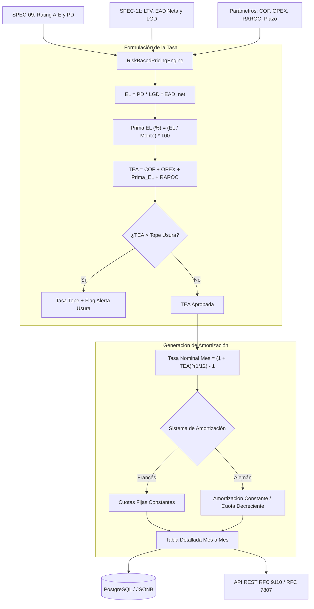

# SPEC-12: Confiamos Risk Engine (CRE) - Motor de Pricing Ajustado al Riesgo (Risk-Based Pricing / RAROC) y Generador de Amortizaciones

- **Estado**: PROPUESTO
- **Cliente**: Cooperativa Confiamos
- **Stack Tecnológico**: Python 3.14, Pydantic v2, FastAPI, LangGraph, Next.js 14, TailwindCSS
- **Autor**: Antigravity & Jorge Sierra
- **Fecha**: 2026-10-26
- **Versión**: 1.0.0
- **Issue Asociado**: [#56](https://github.com/jorge-maikel-sierra/confiamos-risk-engine/issues/56)

---

## 1. Contexto de Negocio y Objetivos

### 1.1 Problema
En el modelo crediticio de **Cooperativa Confiamos**, el motor de suscripción ya clasifica el riesgo en categorías regulatorias A–E (SPEC-09), evalúa la resiliencia en escenarios de choque de ventas y costos (SPEC-10), y cuantifica las segundas fuentes de pago y haircuts de garantías admisibles (SPEC-11).

Sin embargo, el otorgamiento final de un préstamo exige resolver la decisión financiera clave: **¿A qué tasa de interés debe colocarse el crédito y cuál es la cuota mensual exacta que pagará el asociado?**

Actualmente, muchas entidades del sector solidario aplican tasas fijas o escalonadas arbitrariamente, lo que ocasiona:
1. **Selección Adversa (Adverse Selection)**: Se cobra la misma tasa a un asociado con excelente flujo de caja (Rating A) y CDAT pignorado (LTV 40%) que a uno con perfil deficiente (Rating C/D sin colaterales). Esto ahuyenta a los mejores pagadores hacia la banca comercial y concentra cartera de alto riesgo.
2. **Subsidio Cruzado del Riesgo**: Si no se cobra una **Prima por Pérdida Esperada ($EL$)** adecuada al perfil de mora y severidad de pérdida ($PD \times LGD$), los créditos riesgosos erosionan el excedente cooperativo.
3. **Desalineación del Retorno sobre Capital (RAROC)**: El margen financiero no refleja el costo patrimonial de la provisión obligatoria inmovilizada.
4. **Riesgo Regulatorio de Usura**: Al acumular sobrecargos, existe riesgo de superar el límite legal de usura fijado por la Superintendencia Financiera, acarreando sanciones severas y nulidad de intereses.

### 1.2 Objetivo
Implementar en **Confiamos Risk Engine** el subsistema de **Pricing Ajustado al Riesgo (Risk-Based Pricing - RBP)** y el **Generador Determinístico de Tablas de Amortización**:
1. Construir un motor de pricing determinístico (`RiskBasedPricingEngine`) bajo Arquitectura Hexagonal pura.
2. Calcular la tasa de interés requerida por sus componentes canónicos:
   $$\text{TEA Requerida} = \text{Costo de Fondeo (COF)} + \text{Margen Operativo (OPEX)} + \text{Prima por Pérdida Esperada } (EL_{\text{pct}}) + \text{Retorno sobre Capital (RAROC)}$$
3. Formular la **Pérdida Esperada (Expected Loss - $EL$)**:
   $$EL = PD \times LGD \times EAD_{\text{neta}}$$
   - **Probabilidad de Incumplimiento ($PD$)**: Calibrada por la categoría de riesgo (Rating A: $1.5\%$, B: $4.0\%$, C: $12.0\%$, D: $28.0\%$, E: $65.0\%$).
   - **Severidad de Pérdida ($LGD$)**: Función del Loan-to-Value (LTV) y mitigantes admisibles calculados en SPEC-11:
     - $LTV \le 70\%$ o plenamente garantizado: $LGD = 20.0\%$.
     - $LTV \in (70\%, 85\%]$: $LGD = 35.0\%$.
     - $LTV > 85\%$: $LGD = 50.0\%$.
     - Sin garantías (`UNSECURED`): $LGD = 65.0\%$.
   - **Exposición Neta ($EAD_{\text{neta}}$)**: Monto residual tras deducir colaterales admisibles ($V_{\text{adm}}$).
   - $\text{Prima } EL_{\text{pct}} = \left(\frac{EL}{\text{Monto Solicitado}}\right) \times 100$.
4. **Control del Límite Legal de Usura**:
   - Comparar contra la Tasa Máxima Legal de Usura (ej. $28.50\%$ E.A.).
   - Si $\text{TEA Requerida} > \text{Tope de Usura}$, marcar `exceeds_usury_cap: True`, restringir la tasa aplicable al tope y emitir recomendación de exigir colateral admisible adicional para reducir $LGD$ y $EL$.
5. **Generador Determinístico de Amortizaciones**:
   - **Sistema Francés (Cuota Fija Mensual)**:
     $$C = P \times \frac{i \times (1 + i)^n}{(1 + i)^n - 1}$$
   - **Sistema Alemán (Amortización Fija a Capital, Cuota Decreciente)**:
     $$A_t = \frac{P}{n}, \quad I_t = \text{Saldo}_{t-1} \times i, \quad C_t = A_t + I_t$$
   - Inclusión de seguro de cartera mensual ($0.12\%$ sobre saldo deudor).
   - Verificación de cuadre contable: suma de amortizaciones $= P$ y saldo final $= 0.00$.
6. **Endpoints REST (RFC 9110 / RFC 7807)**:
   - `POST /api/v1/underwritings/{application_id}/pricing`: genera o recalcula la propuesta de pricing y tabla de pagos con parámetros personalizados opcionales.
   - `GET /api/v1/underwritings/{application_id}/pricing`: consulta el pricing persistido y la tabla de amortización.
7. **Interfaz Web Interactiva**:
   - Componente [`PricingAmortizationCard.tsx`](file:///Users/jorgesierra/Documents/dev/confiamos-risk-engine/apps/web/src/components/PricingAmortizationCard.tsx) en el detalle del expediente con selector de sistema de amortización (Francés / Alemán), desglose de la tasa (COF, OPEX, Riesgo, Margen), aviso de usura y tabla paginada/desplegable de cuotas mensuales.

### 1.3 Fuera de Alcance (Non-Goals)
- Débito automático bancario o pasarela de recaudo PSE/ACH (se modela el plan financiero contractual).
- Indexaciones a IPC o UVR en cuotas mensuales (el alcance de microcrédito cooperativo se estipula a tasa fija en moneda legal).

---

## 2. Diagramas Arquitectónicos (Mermaid)

### 2.1 Descomposición del Pricing y Plan de Pagos


### 2.2 Arquitectura Hexagonal de Pricing
```mermaid
graph LR
    subgraph Driving Adapters
        HTTP[FastAPI Route /underwritings/{id}/pricing]
    end

    subgraph Application Core
        UC_Pricing[GeneratePricingUseCase]
        UC_Get[GetPricingUseCase]
        Port[PricingEnginePort]
    end

    subgraph Domain
        PricingEngine[RiskBasedPricingEngine]
        AmortEngine[AmortizationEngine]
        Entities[PricingProposal, AmortizationSchedule, PaymentQuota]
    end

    subgraph Driven Adapters
        Repo[PostgresUnderwritingRepository / JSONB pricing_proposal]
    end

    HTTP --> UC_Pricing
    HTTP --> UC_Get
    UC_Pricing --> Port
    Port --> PricingEngine
    PricingEngine --> AmortEngine
    UC_Pricing --> Repo
```

---

## 3. Modelo de Dominio y Fórmulas Matemáticas

### 3.1 Parámetros Base de Mercado y Política Institucional
- **Costo de Fondeo (Cost of Funds - COF)**: $8.50\%$ E.A. (Costo financiero de captaciones CDAT y ahorros).
- **Margen Operativo y Administrativo (OPEX Spread)**: $4.50\%$ E.A. (Costos de intermediación, personal de campo y tecnología).
- **Margen de Retorno sobre Capital (RAROC Target)**: $3.00\%$ E.A. (Excedente neto cooperativo para reservas de estabilización).
- **Tope Máximo Legal de Usura**: $28.50\%$ E.A. (Certificación periódica Superintendencia).

### 3.2 Matriz de Probabilidad de Incumplimiento ($PD$) por Rating
| Rating | Calificación Oficial | $PD$ Anual (%) |
|---|---|---|
| **A** | Riesgo Normal | $1.5\%$ |
| **B** | Con Problemas Potenciales | $4.0\%$ |
| **C** | Deficiente | $12.0\%$ |
| **D** | Difícil Cobro / Dudoso | $28.0\%$ |
| **E** | Pérdida Irrecuperable | $65.0\%$ |

### 3.3 Matriz de Severidad de Pérdida ($LGD$) según Cobertura de Garantía
| Estado de LTV | Rango LTV / Condición | $LGD$ Normativa (%) |
|---|---|---|
| **HEALTHY** | $LTV \le 70.0\%$ o Totalmente Garantizado | $20.0\%$ |
| **WARNING** | $70.0\% < LTV \le 85.0\%$ | $35.0\%$ |
| **CRITICAL** | $LTV > 85.0\%$ | $50.0\%$ |
| **UNSECURED** | Sin Colaterales (A Sola Firma) | $65.0\%$ |

### 3.4 Fórmulas de Amortización
Dado capital prestado $P$, plazo en meses $n$, y tasa periódica mensual $i = (1 + \text{TEA})^{1/12} - 1$:
1. **Sistema Francés**:
   $$C_t = P \cdot \frac{i(1+i)^n}{(1+i)^n - 1}$$
   - Interés: $I_t = \text{Saldo}_{t-1} \cdot i$
   - Amortización: $A_t = C_t - I_t$
   - Seguro: $S_t = \text{Saldo}_{t-1} \cdot 0.0012$
   - Cuota Total con Seguro: $CT_t = C_t + S_t$
   - Saldo: $\text{Saldo}_t = \text{Saldo}_{t-1} - A_t$

2. **Sistema Alemán**:
   $$A_t = \frac{P}{n}$$
   - Interés: $I_t = \text{Saldo}_{t-1} \cdot i$
   - Cuota Pura: $C_t = A_t + I_t$
   - Seguro: $S_t = \text{Saldo}_{t-1} \cdot 0.0012$
   - Cuota Total con Seguro: $CT_t = C_t + S_t$
   - Saldo: $\text{Saldo}_t = \text{Saldo}_{t-1} - A_t$

---

## 4. Diseño de Endpoints REST (RFC 9110 / RFC 7807)

### 4.1 Generar o recalcular propuesta de Pricing y Amortización
- **Método**: `POST`
- **Ruta**: `/api/v1/underwritings/{application_id}/pricing`
- **Request Body (opcional)**:
  ```json
  {
    "amortization_system": "FRENCH", // "FRENCH" | "GERMAN"
    "term_months_override": 36,
    "insurance_rate_monthly": 0.0012
  }
  ```
- **Response 200 OK**:
  ```json
  {
    "application_id": "APP-930E38CE",
    "calculated_at": "2026-10-26T18:50:00Z",
    "requested_amount_usd": 40000.0,
    "term_months": 36,
    "amortization_system": "FRENCH",
    "rating_category": "B",
    "ltv_status": "CRITICAL",
    "cost_of_funds_ea": 8.5,
    "opex_spread_ea": 4.5,
    "expected_loss_usd": 444.44,
    "expected_loss_rate_ea": 1.11,
    "raroc_target_ea": 3.0,
    "recommended_tea": 17.11,
    "monthly_effective_rate": 1.32,
    "usury_cap_tea": 28.5,
    "exceeds_usury_cap": false,
    "monthly_base_quota_usd": 1406.82,
    "monthly_insurance_usd": 48.0,
    "total_monthly_quota_usd": 1454.82,
    "total_interest_usd": 10645.52,
    "total_cost_of_credit_usd": 52373.52,
    "amortization_schedule": [
      {
        "period": 1,
        "beginning_balance": 40000.0,
        "principal_amortization": 878.82,
        "interest_payment": 528.0,
        "insurance_payment": 48.0,
        "total_quota": 1454.82,
        "ending_balance": 39121.18
      }
    ]
  }
  ```

---

## 5. Criterios de Aceptación y Testing (TEST-01 a TEST-06)

- **TEST-01: Cálculo de Pérdida Esperada ($EL$)**:
  Verificar que $EL = PD \times LGD \times EAD_{\text{net}}$ refleje fielmente los cruces de Rating (A–E) y el LTV mitigado de SPEC-11.
- **TEST-02: Composición Aditiva de TEA y Tasa Mensual**:
  Comprobar que $\text{TEA} = \text{COF} + \text{OPEX} + \text{Prima } EL + \text{RAROC}$, y que la tasa mensual equivalente satisfaga $(1 + i_{\text{mes}})^{12} - 1 = \text{TEA}$.
- **TEST-03: Control y Alerta de Techo de Usura**:
  Para un crédito de alto riesgo (Rating D/E sin garantías) cuya TEA supere el $28.50\%$, verificar que `exceeds_usury_cap` sea `True`, la tasa se limite o condicione a mitigantes, y se informe el desborde legal.
- **TEST-04: Tabla de Amortización Francesa (Cuota Fija)**:
  Verificar que:
  1. Todas las cuotas brutas sean idénticas mes a mes.
  2. La suma exacta de la columna `principal_amortization` sea igual a `requested_amount_usd` (error $< \$0.05$ por redondeo).
  3. El `ending_balance` del último periodo sea exactamente $\$0.00$.
- **TEST-05: Tabla de Amortización Alemana (Amortización Constante)**:
  Verificar que:
  1. La amortización mensual de capital sea constante ($P / n$).
  2. Las cuotas totales sean estrictamente decrecientes en el tiempo.
  3. El saldo final termine en $\$0.00$.
- **TEST-06: Endpoints REST y Persistencia RFC 7807**:
  Verificar `POST` y `GET /pricing` retornando 200 OK con payload válido, persistiendo en DB (`pricing_proposal` JSONB), y retornando 404 RFC 7807 ante ID inexistente.
