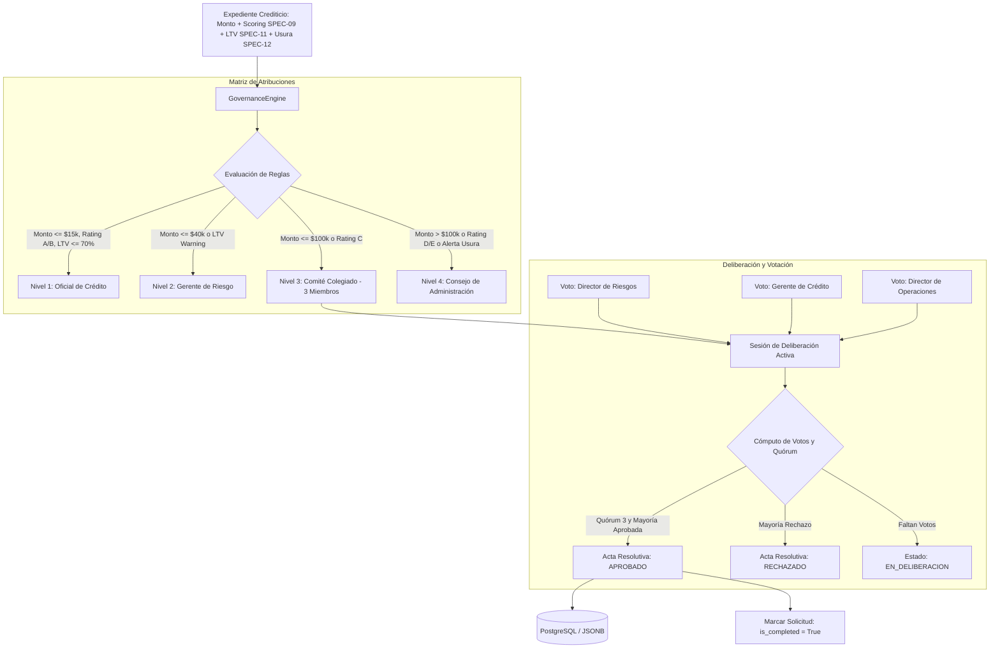

# SPEC-13: Confiamos Risk Engine (CRE) - Matriz de Atribuciones, Comité de Crédito Colegiado y Acta Resolutiva con Covenants

- **Estado**: EN DESARROLLO
- **Cliente**: Cooperativa Confiamos
- **Stack Tecnológico**: Python 3.14, Pydantic v2, FastAPI, LangGraph, Next.js 14, TailwindCSS
- **Autor**: Antigravity & Jorge Sierra
- **Fecha**: 2026-10-30
- **Versión**: 1.0.0
- **Issue Asociado**: [#60](https://github.com/jorge-maikel-sierra/confiamos-risk-engine/issues/60)

---

## 1. Contexto de Negocio y Objetivos

### 1.1 Problema
En el modelo crediticio de **Cooperativa Confiamos**, una vez consolidadas las métricas financieras (SPEC-01), el scoring regulatorio A–E (SPEC-09), las pruebas de estrés (SPEC-10), la valuación de garantías y LTV (SPEC-11), y el pricing ajustado al riesgo con plan de amortización (SPEC-12), el expediente crediticio cuenta con toda la evidencia matemática necesaria.

Sin embargo, el proceso de decisión final de crédito en entidades reguladas por la **Superintendencia de Economía Solidaria (SES)** no puede recaer en una sola persona con un formulario arbitrario, especialmente ante:
1. **Riesgo Operativo y Concentración de Poder**: Dejar créditos de $80,000 USD o con calificaciones deficientes en manos de un solo oficial de crédito genera conflictos de interés y desborda los límites estatutarios de la cooperativa.
2. **Falta de una Matriz Formal de Atribuciones**: No existe un mecanismo determinístico que derive automáticamente qué nivel de gobierno (Oficial, Gerencia, Comité Colegiado o Consejo de Administración) debe sesionar y resolver el crédito en función del monto solicitado, rating, garantías y alertas de usura.
3. **Ausencia de Votación Colegiada y Quórum**: Las decisiones de comité requieren registro nominal de votos (`APROBADO`, `RECHAZADO`, `CONDICIONADO`), cómputo de quórum reglamentario y mayorías calificadas.
4. **Falta de Trazabilidad en Covenants y Condiciones Precedentes**: Cuando se aprueba un crédito con mitigantes (ej: hipoteca en trámite, aporte de CDAT, balances auditados), estas condiciones quedan en notas informales en lugar de constituir compromisos obligatorios en el acta resolutiva oficial.

### 1.2 Objetivo
Implementar en **Confiamos Risk Engine** el subsistema de **Gobernanza Crediticia, Matriz de Atribuciones y Votación Colegiada de Comité**:
1. Construir el motor determinístico de gobernanza (`GovernanceEngine`) bajo Arquitectura Hexagonal pura.
2. Definir la **Matriz de Atribuciones y Facultades Delegadas**:
   - **Nivel 1 - Oficial de Crédito Individual**: Montos $\le \$15,000$ USD, Rating A o B, LTV $\le 70\%$ (Saludable) y sin alertas de usura.
   - **Nivel 2 - Gerente de Riesgo / Agencia**: Montos hasta $\$40,000$ USD o Rating B con garantías Warning ($LTV \in (70\%, 85\%]$).
   - **Nivel 3 - Comité de Crédito Colegiado**: Montos hasta $\$100,000$ USD, o Rating C, o créditos comerciales estándar. Quórum de 3 miembros (Oficial de Riesgos, Gerente de Crédito y Director de Operaciones), requiriendo al menos 2 votos favorables.
   - **Nivel 4 - Consejo de Administración / Junta**: Montos $> \$100,000$ USD, o Rating D/E, o créditos que hayan activado alerta de usura (SPEC-12) o excepciones mayores.
3. Modelar la **Votación Colegiada Multimiembro**:
   - Votos nominales independientes por rol con marcas de tiempo auditables.
   - Cálculo automático de quórum y estado deliberativo (`EN_DELIBERACION`, `APROBADO_DEFINITIVO`, `RECHAZADO_DEFINITIVO`, `APROBADO_CON_CONDICIONES`).
4. Estructurar **Covenants y Condiciones Precedentes**:
   - Compromisos contractuales vinculantes con fecha límite y tipo (financiero, documental o garantía).
5. Generación del **Acta Resolutiva Oficial de Comité**:
   - Folio consecutivo (`ACTA-2026-XXXX`), extracto del dictamen, quórum alcanzado, detalle de votación y fecha de vencimiento de la oferta (30 días).
6. Exponer endpoints REST (RFC 9110 / RFC 7807) para deliberar, votar y consultar la resolución (`GET` y `POST /api/v1/underwritings/{id}/committee/votes`).
7. Componente interactivo en el frontend Next.js 14 (`CommitteeGovernanceCard.tsx`) sustituyendo el antiguo formulario manual de comité.

---

## 2. Diagrama de Flujo de Gobernanza y Comité

---

## 3. Criterios de Aceptación y Testing (TEST-01 a TEST-06)

- **TEST-01: Evaluación Determinística de Niveles de Atribución (Niveles 1 a 4)**:
  Verificar que montos, ratings de riesgo (A-E), ratios LTV y alertas de usura clasifiquen exactamente en el nivel de atribución reglamentario.
- **TEST-02: Registro de Voto Individual y Cómputo de Quórum**:
  Comprobar que los votos emitidos por roles válidos incrementen el quórum y no se dupliquen por el mismo miembro.
- **TEST-03: Resolución Colegiada Aprobada por Mayoría (2 de 3 votos)**:
  Verificar que al alcanzar 2 votos a favor en un comité de 3 miembros, el estado cambie a `APPROVED_BY_COMMITTEE` o `APPROVED_WITH_CONDITIONS`, generando el folio de acta resolutiva (`ACTA-2026-XXXX`).
- **TEST-04: Resolución de Rechazo por Mayoría Negativa**:
  Verificar que al registrarse 2 votos de rechazo, el acta dictamine `REJECTED_BY_COMMITTEE` y la solicitud se cierre como rechazada.
- **TEST-05: Incorporación de Covenants y Condiciones Precedentes**:
  Verificar que los votos condicionados agreguen formalmente los covenants al acta resolutiva con plazo de cumplimiento.
- **TEST-06: Endpoints HTTP REST y Persistencia en Repositorio (RFC 9110 / RFC 7807)**:
  Verificar que `POST` y `GET /committee/votes` persistan en base de datos, actualicen los campos del expediente y respondan 404 Problem Details si el expediente no existe.
