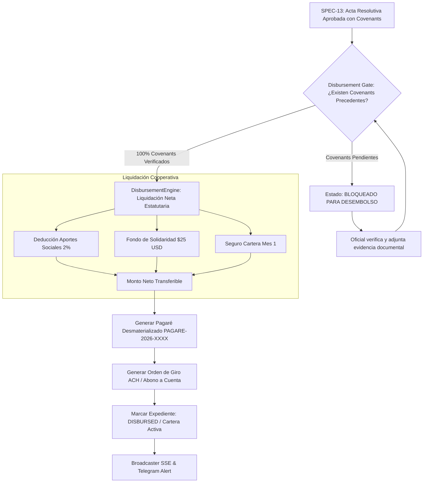

# SPEC-14: Confiamos Risk Engine (CRE) - Compuerta de Desembolso (Disbursement Gate), Verificación de Covenants, Liquidación Cooperativa y Pagaré Digital

- **Estado**: EN DESARROLLO
- **Cliente**: Cooperativa Confiamos
- **Stack Tecnológico**: Python 3.14, Pydantic v2, FastAPI, LangGraph, Next.js 14, TailwindCSS
- **Autor**: Antigravity & Jorge Sierra
- **Fecha**: 2026-11-02
- **Versión**: 1.0.0
- **Issue Asociado**: [#62](https://github.com/jorge-maikel-sierra/confiamos-risk-engine/issues/62)

---

## 1. Contexto de Negocio y Objetivos

### 1.1 Problema
Tras la deliberación del Comité Colegiado y la emisión del Acta Resolutiva Oficial (**SPEC-13**), la cooperativa no puede girar los fondos inmediatamente a la cuenta del asociado sin antes superar la compuerta de desembolso (**Disbursement Gate**):

1. **Riesgo Legal y Contractual (Condiciones Precedentes no Verificadas)**:
   Cuando un crédito se aprueba con mitigantes o condiciones (`APPROVED_WITH_CONDITIONS`), por ejemplo la constitución formal de hipoteca, entrega de póliza endosada o firma de fiador solidario, girar los fondos sin verificar estas condiciones destruye la garantía y vulnera la normativa de la **Superintendencia de la Economía Solidaria (SES)**.
2. **Liquidación Incompleta de Aportes Estatutarios**:
   En el modelo cooperativo, el desembolso no corresponde al 100% del monto solicitado. Los estatutos de **Cooperativa Confiamos** exigen retener:
   - **2.0% del capital en Aportes Sociales Cooperativos** para fortalecer el patrimonio del asociado.
   - **$25.00 USD reglamentarios** para el Fondo de Solidaridad y Auxilio Mutual.
   - **Prima inicial del Seguro de Cartera** del primer mes calculada en SPEC-12.
3. **Ausencia de Título Valor Digital (Pagaré Desmaterializado)**:
   Se requiere generar el pagaré digital único (`PAGARE-2026-XXXX`) con incorporación expresa de la tasa fijada en SPEC-12, plazo pactado, fecha de vencimiento y cláusula aceleratoria aceptada.
4. **Orden de Giro Bancario Inmutable**:
   Debe emitirse la orden de giro oficial (`GIRO-2026-XXXX`) con la cuenta de ahorros o corriente destino, pasando el expediente al estado definitivo `DISBURSED` con trazabilidad completa.

### 1.2 Objetivo
Implementar en **Confiamos Risk Engine** el subsistema de **Compuerta de Desembolso, Verificación de Covenants, Liquidación Cooperativa y Emisión de Pagaré Digital**:
1. Construir el motor determinístico de desembolso (`DisbursementEngine`) bajo Arquitectura Hexagonal pura.
2. Definir los modelos de dominio para `CovenantFulfillmentRecord`, `DisbursementDeductions`, `PromissoryNote` y `DisbursementOrder`.
3. Implementar la validación estricta de condiciones precedentes antes de autorizar el giro, emitiendo HTTP 409 Conflict (RFC 7807) si existen covenants en estado `PENDING`.
4. Calcular de forma exacta la liquidación cooperativa: Deducción de Aportes Sociales (2%), Fondo de Solidaridad ($25 USD) y Seguro del primer mes.
5. Generar el Pagaré Digital Desmaterializado y la Orden de Giro ACH.
6. Exponer endpoints REST (`GET /disbursement`, `POST /disbursement/covenants/{code}/verify`, `POST /disbursement/execute`) con eventos en tiempo real (SSE y alertas Telegram).
7. Diseñar el componente frontend `DisbursementGateCard.tsx` en Next.js 14.

---

## 2. Diagrama de Flujo del Disbursement Gate

---

## 3. Criterios de Aceptación y Testing (TEST-01 a TEST-06)

- **TEST-01: Bloqueo estricto de desembolso ante covenants precedentes pendientes**:
  Verificar que si el acta resolutiva contiene al menos un covenant precedente en estado `PENDING`, la compuerta reporte no elegibilidad y el intento de desembolso falle con error de negocio.
- **TEST-02: Verificación unitaria y levantamiento de covenants con trazabilidad**:
  Comprobar que un oficial pueda marcar un covenant como `FULFILLED` o `WAIVED` con notas de evidencia y timestamp auditable.
- **TEST-03: Cálculo matemático exacto de liquidación neta cooperativa**:
  Verificar que sobre un crédito de $50,000 USD se descuente exactamente el 2% de aportes ($1,000 USD), $25 USD de solidaridad y el seguro del primer mes, resultando en el monto neto exacto.
- **TEST-04: Emisión determinística de Pagaré Desmaterializado (`PAGARE-2026-XXXX`)**:
  Verificar que el pagaré se genere con folio único consecutivo, datos del titular deudor, tasa TEA, plazo y cláusula aceleratoria.
- **TEST-05: Ejecución de giro, transición de estado a `DISBURSED` y emisión de eventos**:
  Verificar que al ejecutarse el desembolso se cree la orden de giro `GIRO-2026-XXXX`, se actualice el estado a `DISBURSED` y se cierre el expediente como completado (`is_completed=True`).
- **TEST-06: Endpoints HTTP REST, Problem Details (RFC 7807) ante 409 Conflict y persistencia**:
  Verificar que los endpoints REST gestionen el ciclo completo, persistan en base de datos y retornen RFC 7807 cuando haya conflicto de negocio.
